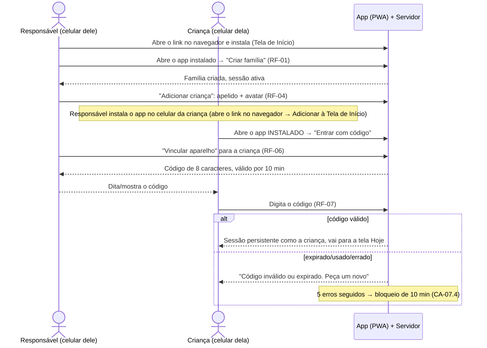
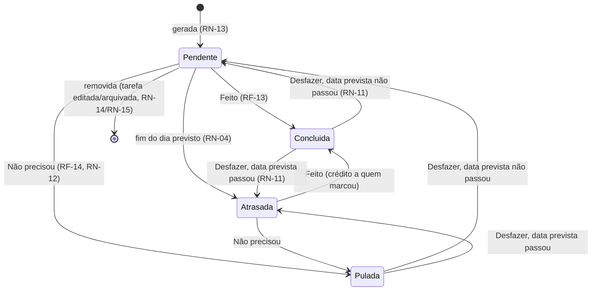
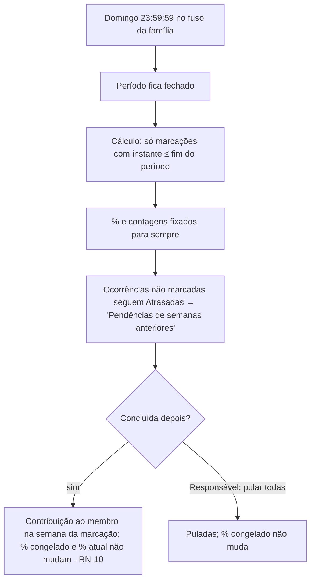
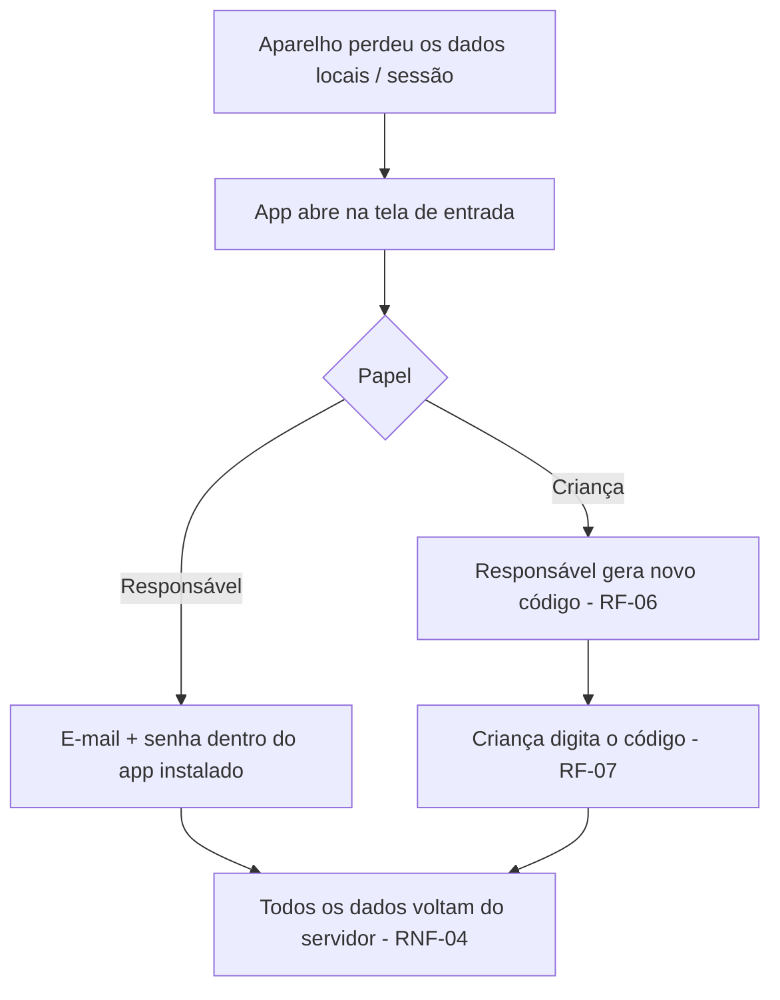
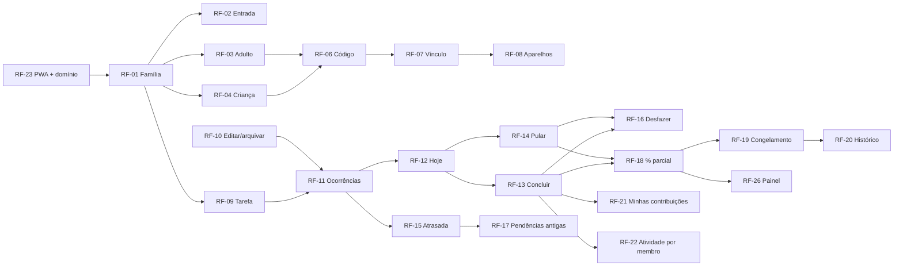

# PRD-TECNICO.md — Tarefas da Casa

> **Status:** rascunho, rodada 1 do Loop A (`/planejar`), 2026-10-16.
> **Base:** `.md/PRD.md`, com o Gate 1 aprovado com ressalvas em `.md/CTO-REVIEW.md`.
> **Escopo:** a Seção 1.1 detalha a **Fase 1 (MVP)**. A Seção 1.2 traz as Fases 2 e 3 em nível alto, **fora do escopo do MVP**.
> **O que este documento não faz:** não decide stack, arquitetura nem modelo de dados. Ele registra requisitos e restrições, e as decisões técnicas são do Coordenador (SDD.md).
> **Decisões que dependem do usuário:** marcadas como **D-nn** e consolidadas na Seção 6.2.

**Glossário**
- **Tarefa:** a definição recorrente. Exemplo: "Pendurar roupa, todos os dias, atribuída a Ana".
- **Ocorrência:** uma instância da tarefa numa data prevista. Exemplo: "Pendurar roupa de 2026-10-20". É a ocorrência que se conclui, pula ou atrasa.
- **Período:** a semana de referência do placar (RN-01).
- **Marcação:** o ato de concluir ou pular uma ocorrência. Registra o membro e o instante, no relógio do servidor.
- **Membro:** um Responsável ou uma Criança.
- **"Qualquer um":** atribuição a nenhum membro específico. A tarefa é da casa.

---

## 1. Requisitos Funcionais

Formato do critério de aceite: EARS ("Quando…, o sistema deve…", "Enquanto…", "Se…, então…"). A prioridade (Must, Should, Could) e o bloco seguem o PRD, Seções 4 e 5.

### 1.1 Fase 1 (MVP)

#### Família e acesso (blocos B2 e B3)

**RF-01: Criar a família e o primeiro Responsável** (Must, B2)
- CA-01.1: Quando não existe família cadastrada e alguém abre o app, o sistema deve oferecer "Criar família", pedindo o nome da família, o apelido do Responsável, o e-mail e a senha.
- CA-01.2: Quando a família é criada, o sistema deve criar o primeiro membro com papel Responsável e deixar esse aparelho com sessão ativa (RNF-05).
- CA-01.3: Enquanto já existe uma família cadastrada, o sistema não deve oferecer "Criar família" (D-13: uma única família).
- CA-01.4: Se o e-mail estiver em formato inválido ou a senha tiver menos de 8 caracteres, então o sistema deve recusar e indicar o campo.

**RF-02: Entrada do Responsável por credencial** (Must, B2)
- CA-02.1: Quando um Responsável informa e-mail e senha válidos dentro do app instalado, o sistema deve criar uma sessão persistente para aquele aparelho (RNF-05).
- CA-02.2: Se a credencial for inválida, então o sistema deve exibir uma mensagem genérica ("E-mail ou senha incorretos") sem revelar qual dos dois está errado.
- CA-02.3: Se houver 5 tentativas inválidas seguidas para o mesmo e-mail, então o sistema deve bloquear novas tentativas desse e-mail por 15 minutos.
- CA-02.4: O fluxo de entrada não deve depender de um link enviado por e-mail (RNF-05, R-P4).

**RF-03: Convidar outro Responsável** (Must, B2)
- CA-03.1: Quando um Responsável escolhe "Adicionar adulto" e informa o apelido, o sistema deve criar o membro com papel Responsável e gerar um código de vínculo do tipo "Responsável" (regras do código em RN-18).
- CA-03.2: Quando o novo adulto digita esse código no app instalado, o sistema deve pedir que ele defina e-mail e senha e, ao concluir, deixar o aparelho com sessão ativa como aquele membro.
- CA-03.3: Se o e-mail já estiver em uso por outro membro, então o sistema deve recusar.

**RF-04: Cadastrar Criança** (Must, B2)
- CA-04.1: Quando um Responsável escolhe "Adicionar criança", o sistema deve pedir **somente** o apelido (de 1 a 20 caracteres) e um avatar escolhido de um conjunto fixo do app.
- CA-04.2: O sistema não deve oferecer campo de e-mail, telefone, foto, data de nascimento, sobrenome ou localização para a Criança (RNF-08).
- CA-04.3: Se o apelido já existir na família, então o sistema deve recusar e pedir outro.

**RF-05: Editar e remover membro** (Must, B2)
- CA-05.1: Quando um Responsável edita o apelido ou avatar de um membro, o sistema deve refletir a mudança em todas as telas, inclusive no histórico.
- CA-05.2: Quando um Responsável remove um membro, o sistema deve aplicar RN-16.
- CA-05.3: Se a remoção deixaria a família sem nenhum Responsável, então o sistema deve impedir.

**RF-06: Gerar código de vínculo de aparelho** (Must, B3) — resolve G-1 (D-01)
- CA-06.1: Quando um Responsável escolhe "Vincular aparelho" para um membro, o sistema deve gerar um código conforme RN-18 e exibi-lo em fonte grande, com a contagem regressiva da validade.
- CA-06.2: Quando um novo código é gerado para o mesmo membro, o sistema deve invalidar o código anterior ainda não usado.
- CA-06.3: (Could, junto de RF-24) o sistema pode exibir também um QR com o **endereço do app**, para facilitar a abertura no navegador e a instalação. O QR **não** carrega o código de vínculo (IR-05).

**RF-07: Vincular aparelho com código** (Must, B3)
- CA-07.1: Quando alguém digita um código válido em "Entrar com código", dentro do app, o sistema deve criar uma sessão persistente daquele aparelho para o membro do código, sem pedir nenhum outro dado.
- CA-07.2: Quando o código é usado, o sistema deve invalidá-lo imediatamente (uso único).
- CA-07.3: Se o código estiver expirado, já tiver sido usado ou não existir, então o sistema deve exibir "Código inválido ou expirado. Peça um novo a um responsável".
- CA-07.4: Se houver 5 códigos errados seguidos a partir do mesmo aparelho, então o sistema deve bloquear novas tentativas desse aparelho por 10 minutos.
- CA-07.5: Um membro pode ter mais de um aparelho vinculado ao mesmo tempo.

**RF-08: Gerenciar aparelhos e sair** (Must, B3)
- CA-08.1: Quando um Responsável abre o perfil de um membro, o sistema deve listar os aparelhos vinculados com o rótulo (sistema e navegador detectados), a data de vínculo e o último uso.
- CA-08.2: Quando um Responsável revoga um aparelho, o sistema deve encerrar aquela sessão. Na próxima requisição, o aparelho vai para a tela de entrada.
- CA-08.3: Quando qualquer membro escolhe "Sair" no próprio aparelho, o sistema deve encerrar a sessão daquele aparelho.

#### Tarefas e ocorrências (blocos B4 e B5)

**RF-09: Cadastrar tarefa** (Must, B4)
- CA-09.1: Quando um Responsável cria uma tarefa, o sistema deve pedir o nome (de 1 a 60 caracteres), a periodicidade e a atribuição (um membro ou "Qualquer um").
- CA-09.2: A periodicidade deve permitir **dias da semana selecionados** (de 1 a 7 dias). Todos os dias equivalem a "diária". Um único dia equivale a "semanal em dia fixo".
- CA-09.3: (Should, H11) A periodicidade deve permitir também **semanal flexível**, uma vez por semana em qualquer dia (RN-04).
- CA-09.4: Quando a tarefa é criada, o sistema deve gerar as ocorrências conforme RN-13, a partir do dia da criação, sem ocorrências retroativas.
- CA-09.5: Se nenhum dia da semana for selecionado na periodicidade por dias, então o sistema deve recusar.

**RF-10: Editar e arquivar tarefa** (Must, B4)
- CA-10.1: Quando um Responsável altera o nome, a periodicidade ou a atribuição, o sistema deve aplicar a mudança conforme RN-14, sem alterar ocorrências já marcadas nem períodos fechados.
- CA-10.2: Quando um Responsável arquiva uma tarefa, o sistema deve parar de gerar ocorrências e aplicar RN-15.
- CA-10.3: Enquanto uma tarefa está arquivada, o sistema deve exibi-la numa lista separada e permitir reativá-la. A reativação gera ocorrências a partir do dia em que acontece.

**RF-11: Gerar ocorrências** (Must, B5)
- CA-11.1: Enquanto uma tarefa está ativa, o sistema deve garantir que exista exatamente uma ocorrência para cada data prevista da periodicidade. Isso vale para todo dia do período aberto a partir do dia da criação ou reativação.
- CA-11.2: Quando qualquer membro abre a tela Hoje, as ocorrências do dia corrente já devem existir, independentemente de alguém ter aberto o app nos dias anteriores (RN-13).
- CA-11.3: Se a ocorrência anterior da mesma tarefa estiver Atrasada, então o sistema deve gerar a próxima ocorrência mesmo assim (I1, RN-05).

**RF-12: Tela Hoje** (Must, B7)
- CA-12.1: Quando um membro abre o app, a tela inicial deve ser "Hoje", com duas seções: **"Para você"** (ocorrências atribuídas a ele) e **"Da casa"** (atribuídas a "Qualquer um" ou a outros membros).
- CA-12.2: Cada seção deve listar as ocorrências não marcadas com data prevista hoje, as semanais flexíveis da semana corrente ainda não marcadas e as Atrasadas do período aberto. As Atrasadas aparecem primeiro e com indicação visual neutra (RN-17).
- CA-12.3: A seção "Da casa" não deve exibir o nome do membro atribuído em nenhuma ocorrência (RN-17).
- CA-12.4: O sistema deve exibir, no topo, o % parcial da semana (RF-18).
- CA-12.5: O sistema deve exibir, ao final, as ocorrências marcadas hoje pelo próprio membro, com a opção de desfazer (RF-16).
- CA-12.6: Quando não há nada a fazer, o sistema deve exibir uma mensagem positiva (por exemplo: "Tudo certo por hoje").

**RF-13: Concluir ocorrência** (Must, B5) — I3
- CA-13.1: Quando um membro toca em "Feito" numa ocorrência Pendente ou Atrasada, **de qualquer atribuição**, o sistema deve mudá-la para Concluída e registrar o membro da sessão como autor do crédito, com o instante da marcação.
- CA-13.2: A conclusão deve exigir **no máximo 1 toque** a partir da tela Hoje, sem diálogo de confirmação. O desfazer (RF-16) substitui a confirmação.
- CA-13.3: Quando a marcação é aceita pelo servidor, o sistema deve dar retorno visual em até 2 s (RNF-12).
- CA-13.4: Se não houver conexão, então o sistema não deve registrar a marcação e deve exibir "Sem conexão. Tente de novo" (D-04).

**RF-14: Pular ocorrência** (Must, B5) — I1
- CA-14.1: Quando um membro autorizado (RN-12) escolhe "Não precisou" numa ocorrência Pendente ou Atrasada, o sistema deve mudá-la para Pulada, registrando o membro e o instante.
- CA-14.2: O pulo deve exigir no máximo 2 toques: abrir as opções da ocorrência e escolher "Não precisou". O motivo é opcional, em texto livre de até 80 caracteres.
- CA-14.3: Quando a ocorrência fica Pulada, o sistema deve excluí-la do numerador e do denominador do % (RN-08) e não contá-la como atraso.
- CA-14.4: Se o membro não estiver autorizado a pular aquela ocorrência (RN-12), então o sistema não deve exibir a opção.

**RF-15: Estado Atrasada** (Must, B5) — I1
- CA-15.1: Quando termina o dia da data prevista (23:59:59 no fuso da família) e a ocorrência continua Pendente, o sistema deve tratá-la como Atrasada (RN-04).
- CA-15.2: Enquanto Atrasada, a ocorrência deve continuar visível até ser Concluída ou Pulada, inclusive depois de o período fechar (RF-17).

**RF-16: Desfazer marcação** (Should, B5)
- CA-16.1: Quando o autor da marcação ou um Responsável escolhe "Desfazer" numa ocorrência Concluída ou Pulada cuja marcação foi feita no período aberto, o sistema deve devolvê-la ao estado anterior: Pendente se a data prevista ainda não passou, Atrasada se já passou.
- CA-16.2: Se a marcação foi feita num período já fechado, então o sistema não deve oferecer "Desfazer" (RN-11).

**RF-17: Pendências de semanas anteriores** (Should, B5)
- CA-17.1: Enquanto existirem ocorrências Atrasadas com data prevista num período fechado, o sistema deve exibi-las numa seção recolhida, "Pendências de semanas anteriores", agrupadas por tarefa e com a quantidade (por exemplo, "Pendurar roupa — 3").
- CA-17.2: Quando um Responsável escolhe "Marcar todas como 'Não precisou'" num grupo, o sistema deve pular todas as ocorrências daquele grupo de uma vez.
- CA-17.3: Quando uma dessas ocorrências é concluída ou pulada, o sistema deve aplicar RN-10, sem alterar o % congelado.

#### Placar e painel (blocos B6 e B7)

**RF-18: % parcial da semana corrente** (Must, B6) — I2
- CA-18.1: Enquanto o período está aberto, o sistema deve exibir o % parcial calculado conforme RN-08 ("Semana até agora: 75%").
- CA-18.2: Quando uma marcação ou um desfazer é aceito, o % deve refletir a mudança na próxima vez que a tela for exibida ou atualizada.
- CA-18.3: Se o denominador for zero, então o sistema deve exibir "Sem tarefas previstas ainda", e não 0% nem 100% (RN-09).

**RF-19: Fechamento e congelamento da semana** (Must, B6) — I2
- CA-19.1: Quando o período termina (RN-01), o sistema deve fixar o % final e as contagens do período (previstas, concluídas, puladas, não feitas) considerando **somente marcações com instante ≤ fim do período** (RN-09).
- CA-19.2: Depois de fixado, o % do período não deve mudar por nenhum evento posterior: conclusão tardia, desfazer, edição ou arquivamento de tarefa, remoção de membro ou introdução de peso na Fase 2.
- CA-19.3: O resultado deve ser o mesmo se o fechamento for calculado no instante do fim do período ou depois, por exemplo na primeira abertura do app na segunda-feira (IR-07).

**RF-20: Histórico de semanas fechadas** (Should, B6)
- CA-20.1: Quando um membro abre "Semanas anteriores", o sistema deve listar os períodos fechados, do mais recente para o mais antigo, com as datas e o % congelado.
- CA-20.2: O histórico não deve exibir divisão por pessoa (RN-17).

**RF-21: Minhas contribuições** (Must, B7)
- CA-21.1: Quando um membro abre "Minhas contribuições", o sistema deve exibir quantas ocorrências **ele** concluiu na semana corrente e em cada uma das últimas 4 semanas, contadas pelo instante da marcação (RN-10).
- CA-21.2: A tela não deve comparar o membro com outros nem exibir as ocorrências que ele não fez.

**RF-22: Atividade por membro (Responsáveis)** (Should, B6) — instrumento da métrica M1
- CA-22.1: Quando um Responsável abre "Atividade da família", o sistema deve exibir, para cada membro e para cada uma das últimas 12 semanas, o número de marcações (concluídas + puladas) feitas por ele e um indicador "ativo na semana" (≥ 1 marcação).
- CA-22.2: A tela deve exibir, para a família, quantas das últimas 12 semanas tiveram **todos** os membros ativos (M1).
- CA-22.3: Esta tela só deve estar disponível para o papel Responsável e não deve ordenar os membros por desempenho (RN-17).

**RF-26: Painel da casa** (Must, B7) — I6
- CA-26.1: Quando um membro abre "Casa", o sistema deve exibir o % parcial da semana, o % congelado da semana anterior e a quantidade de tarefas concluídas na semana pela família, sem divisão por pessoa.
- CA-26.2: Todos os textos do painel devem seguir RN-17.

#### Instalação (bloco B1)

**RF-23: PWA instalável no domínio definitivo** (Must, B1)
- CA-23.1: Quando o app é aberto pelo Safari do iOS 16.4+ ou pelo Chrome do Android, ele deve atender aos critérios de instalação de cada plataforma: manifest com nome, ícones e modo standalone, além do service worker.
- CA-23.2: Quando aberto pelo ícone da Tela de Início, o app deve rodar em modo standalone, sem a barra do navegador.
- CA-23.3: O app deve ser servido por HTTPS, na origem definitiva (D-02, RNF-06).

**RF-24: Instruções de instalação no app** (Could, B1)
- CA-24.1: Quando o app é aberto no navegador, e não instalado, o sistema deve exibir instruções curtas de instalação para a plataforma detectada (iOS: Compartilhar → Adicionar à Tela de Início).

**RF-25: Concluir em nome de outro membro** (Could, B5)
- CA-25.1: Quando um Responsável escolhe "Feito por…" numa ocorrência e seleciona um membro, o sistema deve registrar a Conclusão com o crédito para o membro escolhido e guardar o Responsável que fez o registro.

### 1.2 Fases 2 e 3 (roadmap, FORA do escopo do MVP, em nível alto)

Os critérios de aceite detalhados serão escritos quando a fase for aberta (regra de passagem do PRD, Seção 4).

| ID | Fase | Requisito de alto nível | Ideia | Restrições já conhecidas |
|---|---|---|---|---|
| RF-F2-01 | 2 | Peso de esforço de 1 a 3 por tarefa. O % passa a ser ponderado: soma dos pesos das concluídas ÷ soma dos pesos das (previstas − puladas) | I5 | **Semanas fechadas antes da introdução do peso não são recalculadas (RN-09).** Tarefas existentes recebem peso 1 por padrão |
| RF-F2-02 | 2 | Rodízio automático: uma lista ordenada de membros por tarefa, e cada nova ocorrência é atribuída ao próximo da lista | I4 | O rodízio não restringe quem pode concluir (I3 continua valendo). Ainda falta definir como Atrasada e Pulada afetam a vez |
| RF-F2-03 | 2 | Recorrência "N dias depois da última conclusão": a data prevista da próxima ocorrência é a data da última conclusão + N | I4 | Exceção à regra "próxima gerada mesmo se atrasada" (RN-05). Ainda falta definir o efeito do pulo na contagem |
| RF-F3-01 | 3 | Inscrição de push por aparelho, com pedido de permissão disparado por um toque do usuário (exigência do iOS) e válida só no app instalado | I8 | Depende de RF-23 e da origem definitiva (R-P3). Exige agendamento no servidor |
| RF-F3-02 | 3 | Lembrete das ocorrências do dia para o membro atribuído | I8 | Linguagem neutra (RN-17) |
| RF-F3-03 | 3 | Horário de silêncio de 22h às 07h (fuso da família) e no máximo 1 aviso de atraso, agrupado, por membro por dia | I8 | — |
| — | Dormente | Corte do plano grátis: o grátis nunca mostra a divisão por pessoa | I7 | Só se comercializar |

---

## 2. Requisitos Não-Funcionais

| ID | Requisito | Critério verificável | Origem |
|---|---|---|---|
| RNF-01 | **Plataformas** | Funciona no Safari do iOS/iPadOS 16.4+ como app instalado na Tela de Início, no Chrome atual do Android (instalado e no navegador) e no navegador de computador (Chrome, Edge e Safari atuais) para as telas do Responsável | Q-F3, PLANO §3 |
| RNF-02 | **Atrito de marcação** | Do toque no ícone do app até a marcação confirmada: ≤ 10 s em 4G ou Wi-Fi doméstico, com no máximo 1 toque dentro do app para concluir (RF-13) | A3, M3 |
| RNF-03 | **Esforço de cadastro** | Criar a família, adicionar 2 adultos e 3 crianças e cadastrar 10 tarefas leva ≤ 15 min para quem já conhece o app | A2, M3 |
| RNF-04 | **Servidor como fonte da verdade (R-P5)** | Nenhum dado da família existe só no aparelho. Se o armazenamento local de um aparelho for apagado, nenhum dado é perdido, e o membro volta a usar em ≤ 2 min: o Responsável com e-mail e senha, a Criança com um novo código | R-P5 |
| RNF-05 | **Sessão persistente e criada dentro do app (R-P4)** | A sessão de aparelho não expira enquanto o app for usado ao menos 1 vez a cada 60 dias, e é revogável (RF-08). Toda entrada (RF-02, RF-07) acontece **dentro do app instalado**: nenhum fluxo depende de link aberto fora dele. Orientação operacional: instalar primeiro e entrar depois | R-P4, A3 |
| RNF-06 | **Origem definitiva (R-P3)** | Nenhuma instalação em aparelho da família acontece fora do domínio definitivo. URLs provisórias, de preview ou de desenvolvimento são usadas só pelo desenvolvedor | R-P3, D-02 |
| RNF-07 | **Sem pausa por inatividade (R-P8)** | Depois de 30 dias seguidos sem nenhum acesso da família, o app volta a funcionar no primeiro acesso, sem intervenção manual do usuário, e sem perda de dados. A forma de atender (stack sem pausa, manutenção automática de atividade ou plano pago dentro do teto) é decisão do Coordenador (D-05) | R-P8, Supabase docs |
| RNF-08 | **Minimização de dados de menores (R-P6)** | A Criança é representada só por apelido e avatar de um conjunto fixo. Não há e-mail, telefone, foto, data de nascimento, sobrenome nem localização. Não há analytics, anúncio ou rastreador de terceiros em nenhuma tela. Os dados do adulto se limitam a apelido, e-mail e hash de senha | LGPD art. 14, ECA Digital (PLANO R-P6) |
| RNF-09 | **Segurança básica** | Somente HTTPS. Todo dado só é acessível com sessão válida da família. Códigos de vínculo conforme RN-18. Senhas guardadas só como hash forte. Sessões revogáveis do lado do servidor | RF-02, RF-07 |
| RNF-10 | **Comportamento sem rede** | Sem rede, o app instalado abre e exibe "Sem conexão" em vez de tela de erro do navegador. Nenhuma marcação é registrada offline (D-04) | R-P5, D-04 |
| RNF-11 | **Usabilidade para crianças de ~7 anos** | Interface em pt-BR, ações principais com ícone + texto, alvos de toque ≥ 44×44 pt e texto base ≥ 16 px. Nenhuma ação destrutiva (remover, arquivar, revogar) fica disponível ao papel Criança | A1 |
| RNF-12 | **Tempo de resposta** | Marcação e desfazer confirmados em ≤ 2 s (p95) em 4G. Tela Hoje carregada em ≤ 3 s (p95) depois de aberta | A3 |
| RNF-13 | **Backup** (Should) | Existe uma cópia dos dados da família recuperável, com no máximo 7 dias de defasagem, e o procedimento de restauração está documentado (DEPLOY.md) | R-P5 (lado servidor) |
| RNF-14 | **Custo** | Custo recorrente ≤ R$ 10/mês (referência), com alvo de ~R$ 3,33/mês (domínio) | PLANO §6.1 |
| RNF-15 | **Fuso horário único** | Todas as regras de data (dia, virada para Atrasada, período) usam o fuso America/Sao_Paulo, independentemente do fuso do aparelho | RN-01, D-06 |
| RNF-16 | **Orçamento de esforço** | O esforço da Fase 1 é ≤ **150 h** (teto atualizado em 2026-10-16; antes 90 h). A lista de corte do PRD (Seção 5) é reserva: se o andamento real (horas gastas + estimativa das tarefas restantes do TASK.md) passar de 150 h, o Coordenador propõe o próximo item da lista, e ele só sai com aprovação do usuário. O teto não sobe de novo sem reabrir o Gate 1 | Gate 1, ressalva 1 (atualizada em 2026-10-16); TASK.md §5.2 |

---

## 3. Regras de Negócio

| ID | Regra | Racional |
|---|---|---|
| RN-01 | **Período = semana de segunda 00:00:00 a domingo 23:59:59**, no fuso da família (America/Sao_Paulo) (D-06) | A semana é o ritmo natural da casa e o período do placar. Começar na segunda segue o padrão ISO e permite fechar a semana no domingo à noite |
| RN-02 | **Estados da ocorrência:** Pendente, Atrasada, Concluída e Pulada. Concluída e Pulada são **marcados**; Pendente e Atrasada são **não marcados**. Transições permitidas: Pendente → Concluída/Pulada/Atrasada; Atrasada → Concluída/Pulada; Concluída/Pulada → Pendente/Atrasada (só por desfazer, RN-11). Não existe Concluída ↔ Pulada direta: é preciso desfazer antes | O estado "checada mas não feita" do pedido original é a Pulada. Separar marcados de não marcados simplifica o % e a regra de atraso |
| RN-03 | **Uma ocorrência pertence ao período da sua data prevista** e a nenhum outro | Garante que cada ocorrência entre em exatamente um % |
| RN-04 | **Atrasada:** uma ocorrência não marcada cuja data prevista já terminou (00:00 do dia seguinte, no fuso da família). Na semanal flexível, a data prevista é o domingo da semana, e ela fica disponível desde segunda | I1. O atraso é fato de calendário, não julgamento |
| RN-05 | **A próxima ocorrência é gerada mesmo se a anterior estiver Atrasada.** As atrasadas não se fundem nem se substituem | I1: a fila não trava, e cada dia não feito permanece visível até ser resolvido |
| RN-06 | **Crédito:** a Concluída é creditada ao membro da sessão que marcou, independentemente da atribuição (exceção: RF-25, Could, em que o crédito vai para o membro escolhido pelo Responsável) | I3: ajudar o outro conta |
| RN-07 | **Pulada não pontua e não é atraso:** sai do numerador e do denominador | I1: não punir quem não teve o que fazer |
| RN-08 | **Cálculo do %.** Seja **P** o conjunto de ocorrências do período considerado, **C** as Concluídas e **S** as Puladas dentro de P. **% = \|C\| ÷ (\|P\| − \|S\|) × 100.** No **período fechado**, P = todas as ocorrências do período. No **período aberto (parcial)**, P = ocorrências do período com data prevista ≤ hoje, **mais** as já marcadas com data prevista futura (por exemplo, uma semanal flexível concluída na terça). Exemplo de parcial: até quarta, 10 ocorrências previstas, 6 concluídas, 2 puladas e 2 atrasadas → 6 ÷ (10 − 2) = **75%**. Exemplo de fechamento: 20 previstas, 14 concluídas, 3 puladas e 3 não feitas → 14 ÷ 17 = 82,35% → **82%** | É o pedido original ("% de tarefas da casa concluídas") com I1 aplicada. O parcial não penaliza ocorrências que ainda não venceram |
| RN-09 | **Congelamento e exibição.** (a) O % e as contagens de um período fechado são calculados considerando somente marcações com instante ≤ fim do período, e **nunca são recalculados** depois. (b) Exibição: inteiro **truncado** (82,9% → 82%), então 100% só aparece quando todas as ocorrências estão concluídas. (c) Denominador zero → "Sem tarefas previstas", sem número (D-12) | I2: o número da semana vira fato combinado. O truncamento evita um "100%" com pendência |
| RN-10 | **Conclusão tardia** (ocorrência de período fechado concluída depois do fechamento): a ocorrência passa a Concluída e o membro recebe a contribuição na semana em que **marcou** (RF-21 e RF-22), mas o % congelado do período original **não muda**, e a ocorrência **não entra** no % do período corrente (D-10) | Respeita I2 sem esconder o esforço (I3). Não entrar no % corrente evita inflar a semana atual com dívida antiga |
| RN-11 | **Desfazer:** permitido ao autor da marcação ou a um Responsável, só se a marcação foi feita no **período aberto atual**. Ao desfazer, a ocorrência volta para Pendente ou Atrasada conforme a data prevista | Corrige toque acidental sem permitir reescrever semanas fechadas (I2) |
| RN-12 | **Permissões de marcação** (D-07). **Concluir:** qualquer membro, em qualquer ocorrência. **Pular:** um Responsável em qualquer ocorrência; uma Criança só nas atribuídas a ela ou a "Qualquer um" | Pular remove a ocorrência do denominador e sobe o %. Limitar o pulo da criança às próprias protege o placar sem burocracia. Concluir é sempre livre (I3) |
| RN-13 | **Geração de ocorrências:** uma ocorrência por data prevista (cada dia selecionado, ou uma por semana na semanal flexível), começando no dia da criação ou reativação da tarefa (inclusive, se o dia corresponder). Nunca há ocorrências retroativas | Uma tarefa criada na quarta não gera atraso de segunda e terça |
| RN-14 | **Edição de tarefa:** muda só ocorrências **não marcadas com data prevista ≥ amanhã**, que são regeneradas pela nova regra. As de hoje, as passadas, as marcadas e os períodos fechados ficam como estão. Mudar só o nome reflete em todas as telas, inclusive no histórico | Evita alterar a base do % de forma retroativa no meio do dia. Renomear não muda número nenhum |
| RN-15 | **Arquivamento de tarefa:** remove as ocorrências não marcadas com data prevista ≥ hoje (elas saem do denominador do período aberto). As Atrasadas existentes **permanecem** até serem concluídas ou puladas (I1) | Arquivar não deve apagar dívida real nem gerar atraso futuro |
| RN-16 | **Remoção de membro:** (a) as tarefas e ocorrências não marcadas atribuídas a ele passam para "Qualquer um"; (b) todos os aparelhos dele são revogados; (c) as marcações dele permanecem e passam a aparecer como "Ex-membro", sem apelido nem avatar; (d) os % congelados não mudam | Minimização (RNF-08) sem quebrar o histórico nem o I2 |
| RN-17 | **Linguagem neutra (I6).** (a) Nenhuma tela compartilhada (Hoje → "Da casa", Casa, Semanas anteriores) associa nome de membro a ocorrência Atrasada, Pulada ou não feita. (b) Não há ranking, ordenação por desempenho nem % individual em nenhuma tela. (c) Os textos de atraso descrevem a tarefa, não a pessoa: "Ficou de ontem", nunca "Fulano não fez". (d) Palavras proibidas nos textos do app: "culpa", "falhou", "preguiça", "devendo", "punição" e equivalentes. (e) RF-22 é a única visão por membro, só para Responsáveis, e mostra só atividade (contagem de marcações), sem destacar ausência | I6: protege a adesão das crianças e evita que o app vire instrumento de briga. I7 (dormente) não se confunde com isto: aqui a divisão por pessoa é uma escolha de produto familiar, não um corte de plano |
| RN-18 | **Código de vínculo:** ≥ 8 caracteres de um alfabeto sem símbolos ambíguos (sem 0/O, 1/I/L); uso único; validade de 10 minutos; ligado a um membro e a um tipo (Criança ou Responsável); invalidado quando outro código é gerado para o mesmo membro; limite de tentativas conforme CA-07.4 | Permite sessão sem conta (G-1) com risco baixo: a janela é curta, o código é de uso único e só um Responsável o gera |
| RN-19 | **Atribuição não restringe quem conclui:** a atribuição só define em qual seção a ocorrência aparece ("Para você" ou "Da casa") e, para a Criança, o que ela pode pular (RN-12) | I3 |
| RN-20 | **Papéis e permissões.** Responsável: tudo. Criança: ver Hoje, Casa, Semanas anteriores e Minhas contribuições; concluir; pular conforme RN-12; desfazer as próprias marcações (RN-11); sair do próprio aparelho. A Criança **não** cadastra, edita, arquiva nem remove nada, e não vê RF-22 nem a gestão de aparelhos | Simplicidade e proteção do placar |
| RN-21 | **Uma família por instalação do sistema** (D-13) | Uso pessoal. Várias famílias só se comercializar (Anexo A), e aí exige reanálise |

---

## 4. Fluxos de Usuário/Processo

### F1: Configuração inicial e vínculo do celular da criança (resolve G-1)



Decisões do fluxo: o código é digitado **dentro do app instalado**, nunca por link ou QR aberto no Safari, porque a sessão do Safari não passa para o app instalado (R-P4, IR-05). O adulto adicional segue o mesmo fluxo, com o código do tipo Responsável, e depois define e-mail e senha (RF-03).

### F2: Ciclo de vida da ocorrência (RN-02)



Observações:
- Desfazer só é permitido se a marcação aconteceu no período aberto atual.
- A próxima ocorrência é gerada independentemente do estado desta (RN-05).

### F3: Marcar uma tarefa (caminho crítico de RNF-02)

```mermaid
flowchart TD
    A[Toque no ícone do app] --> B{Sessão válida?}
    B -- não --> L[Tela de entrada: código ou e-mail/senha]
    B -- sim --> H[Tela Hoje]
    H --> O{Ação na ocorrência}
    O -- "Feito" (1 toque) --> N{Com conexão?}
    O -- "..." → "Não precisou" --> P{Pode pular? RN-12}
    P -- não --> X[Opção não exibida]
    P -- sim --> N
    N -- não --> E[Sem conexão. Tente de novo]
    N -- sim --> S[Servidor registra membro + instante]
    S --> V[Retorno visual em até 2 s, % parcial atualizado]
    V --> U{Desfazer?}
    U -- sim, período aberto --> R[Volta para Pendente/Atrasada]
```

### F4: Fechamento da semana (RN-09)



O fechamento pode ser materializado no instante exato ou na primeira leitura posterior. O resultado tem que ser idêntico (CA-19.3), e a forma é decisão do Coordenador.

### F5: Recuperação após perda do armazenamento local (R-P5)



### F6: Responsável sem acesso (sem recuperação por e-mail na Fase 1, D-11)

Outro Responsável gera um código do tipo Responsável para ele (RF-06 → RF-07). Se não houver outro Responsável, o usuário-desenvolvedor redefine a senha manualmente, por procedimento documentado.

---

## 5. Dependências entre Requisitos e Integrações Externas

### 5.1 Dependências entre requisitos (o que bloqueia o quê)



Dependências críticas:
- **RF-23 com o domínio definitivo (D-02)** vem antes de **qualquer** instalação em aparelho da família (R-P3).
- **RF-19** depende do fuso e do período definidos (D-06).
- **Fase 2 (RF-F2-01)** depende de RF-19: o peso não pode recalcular semanas fechadas.
- **Fase 3 (RF-F3-01)** depende de RF-23 e de RNF-06.

### 5.2 Integrações externas

| Integração | Fase | Para quê | Restrição/risco | Responsável pela escolha |
|---|---|---|---|---|
| Registro de domínio (Registro.br para `.com.br`, ou subdomínio de domínio que o usuário já tenha) + DNS | 1 | Origem definitiva (RNF-06) | Irreversível depois da primeira instalação (R-P3). ~R$ 40/ano | Usuário (D-02) |
| Hospedagem do front-end estático com HTTPS | 1 | Servir o PWA | Free tier. Precisa permitir servir o manifest e o service worker na raiz da origem | Coordenador |
| Back-end + banco de dados | 1 | Fonte da verdade (RNF-04), sessões e regras de negócio | **Não pode pausar sem reativação automática (RNF-07).** Exemplo conhecido: o Supabase Free pausa após 7 dias de baixa atividade | Coordenador (D-05) |
| Navegadores-alvo: Safari iOS 16.4+ e Chrome Android | 1 | Instalação, standalone e armazenamento | No iOS, o armazenamento do app instalado é separado do Safari (R-P4) | — (restrição de plataforma) |
| Serviços de Web Push dos navegadores (Apple, Google), com chaves VAPID e agendador no servidor | **3** | Lembretes (I8) | Só no app instalado e com permissão pedida por gesto (R-P1) | Coordenador, na Fase 3 |
| Provedor de e-mail | **Nenhuma na Fase 1** | — | Evitado de propósito: não há verificação de e-mail nem recuperação por link (D-11) | — |
| Analytics, anúncios e SDKs de terceiros | **Proibido** | — | RNF-08 | — |

---

## 6. Premissas e Riscos Resolvidos

### 6.1 Premissas e riscos herdados (PRD Seção 6 e PLANO Seção 7)

| ID | Situação | Evidência / raciocínio | Resolução |
|---|---|---|---|
| **G-1** (sessão própria da criança sem conta) | **Resolvido por proposta. A confirmar pelo usuário (D-01)** | O link mágico por e-mail e o QR com link abrem no Safari, cuja sessão não passa para o app instalado no iOS (fontes: [Netguru](https://www.netguru.com/blog/how-to-share-session-cookie-or-state-between-pwa-in-standalone-mode-and-safari-on-ios), [Progressier](https://progressier.com/pwa-capabilities/cookies-demo)). Um código digitado dentro do app instalado cria a sessão no lugar certo e dispensa qualquer identificador pessoal da criança | RF-06, RF-07, RF-08, RN-18. Nenhum dado além de apelido e avatar (RNF-08) |
| **R-P3** (domínio irreversível) | **Resolvido como requisito + ação do usuário (D-02)** | Instalação, armazenamento e inscrição de push ficam presos à origem (comportamento padrão de origem web; detalhe não reverificado) | RNF-06. O usuário escolhe o domínio antes da primeira instalação em aparelho da família. URLs de preview só para desenvolvimento |
| **R-P5** (perda do armazenamento local no iOS) | **Parcialmente validado; mitigado por requisito** | Segundo a WebKit, apps na Tela de Início têm contador próprio de dias de uso, reiniciado pelo uso, e a perda de dados first-party seria "bug sério" ([Search Engine Land](https://searchengineland.com/what-safaris-7-day-cap-on-script-writeable-storage-means-for-pwa-developers-332519), [The Register](https://www.theregister.com/2020/03/26/apple_relax_were_not_totally/)). Um relato de 2022 mostra logout após 7 dias mesmo com o app em uso ([WebKit bug 237350](https://bugs.webkit.org/show_bug.cgi?id=237350)). Conclusão: a perda é improvável, mas possível | RNF-04 (servidor como fonte da verdade, recuperação em ≤ 2 min), F5 e D-04 (sem marcação offline, então não há dado pendente no aparelho) |
| **R-P8** (pausa do free tier) | **Validado (o risco é real); mitigado por requisito** | A documentação do Supabase confirma a pausa de projetos Free após 7 dias de baixa atividade e a isenção dos planos pagos ([Supabase docs](https://supabase.com/docs/guides/platform/free-project-pausing)). Existem soluções comunitárias de keep-alive ([exemplo](https://github.com/travisvn/supabase-pause-prevention)), mas não oficiais | RNF-07 (30 dias sem acesso → volta sozinho). Escolha do Coordenador (D-05) |
| **R-P4** (login duplo no iOS) | **Validado; mitigado por fluxo** | O app instalado no iOS tem cookies, Web Storage e IndexedDB isolados do Safari (fontes do G-1) | RNF-05: toda entrada acontece dentro do app instalado. Orientação: instalar primeiro e entrar depois |
| **R-P1** (push no iOS) | **Fora da Fase 1** | Os aparelhos têm iOS 16.4+ (usuário) | RF-F3-01 |
| **R-P2** (instalação manual no iOS) | **Premissa mantida** | O usuário instala pessoalmente em cada aparelho (bloco B8) | RF-24 (Could) como reforço |
| **R-P6** (dados de menores) | **Resolvido por minimização** | LGPD art. 14 (consentimento de um dos pais para dados de criança) e ECA Digital, conforme citados no PLANO. Em uso familiar, o Responsável que cadastra é o próprio pai ou mãe, então o consentimento é implícito no ato de cadastro `[PREMISSA]`. O texto legal não foi relido nesta rodada | RNF-08, RN-16(c). Refazer a análise se comercializar |
| **R-P7** (super-engenharia) | **Mitigado, continua monitorado** | Escopo congelado, teto de 150 h (desde 2026-10-16), lista de corte como reserva e regra de passagem: nenhuma fase seguinte começa sem 2 semanas de uso real da Fase 1 por toda a família | PRD Seções 4 e 5, RNF-16, Gate 1 ressalvas 1 e 4 |
| **A1 a A5** | **Não validáveis antes do uso: continuam abertas, com dono e prazo** (PRD Seção 6) | Dependem de comportamento real da família | Instrumentos: RF-22 (A1, M1), cronometragem (A2, A3), bloco B8 (A5), estimativa do Coordenador e data-limite (A4) |

### 6.2 Decisões a confirmar com o usuário

| ID | Decisão proposta pelo Gestor | Alternativa | Impacto se mudar |
|---|---|---|---|
| **D-01** (G-1) | Sessão da criança por **código de vínculo de uso único**: 8 caracteres, 10 min, gerado por um Responsável e digitado no app instalado da criança. Sem conta, e-mail ou senha para a criança. O mesmo mecanismo serve para adicionar adulto e para re-vincular aparelho | QR lido pela câmera dentro do app (mais caro); conta Google da criança (contraria R-P6) | Alto: afeta B3 (~8 h) |
| **D-02** (R-P3) | Registrar um domínio `.com.br` (~R$ 40/ano) **ou** usar um subdomínio de domínio que o usuário já tenha, **antes de qualquer instalação em aparelho da família**. **Pergunta: qual domínio?** | Domínio gratuito do provedor de hospedagem (ex.: `*.pages.dev`), que funciona mas também fica preso para sempre e depende do provedor | Irreversível depois da primeira instalação |
| **D-03** | Data-limite para a Fase 1 estar em uso real: **8 semanas** a partir da aprovação do `/definir`. **Pergunta: qual data?** | Outra data | Protege A4 e M2 |
| **D-04** (R-P5) | O servidor é a fonte da verdade, e **marcar exige conexão** (sem fila offline na Fase 1) | Marcação offline com sincronização (mais horas, risco de conflito) | Médio: +horas e risco no B5 |
| **D-05** (R-P8) | Exigir apenas o resultado (RNF-07: 30 dias parado → volta sozinho) e deixar o como para o Coordenador. Pagar um plano só se couber em ≤ R$ 10/mês | Aceitar a reativação manual (risco nas férias) | Baixo a médio |
| **D-06** | Semana de **segunda a domingo**, fuso America/Sao_Paulo | Domingo a sábado | Baixo antes do primeiro fechamento; irreversível depois (I2) |
| **D-07** | **Criança pula** só as próprias ocorrências ou as de "Qualquer um". **Concluir** é livre para todos | Criança não pula nada / criança pula tudo | Placar e autonomia da criança |
| **D-08** | Gatilho de reordenação: se as crianças **esquecem** de marcar nas semanas 2 e 3, a Fase 3 (lembretes) vem antes da Fase 2 | Manter a ordem fixa | Ordem do roadmap |
| **D-09** | Painel compartilhado **sem divisão por pessoa**. Cada membro vê só as próprias contribuições. Responsáveis veem a atividade por membro (contagem, sem ranking) | Mostrar o placar individual para todos (risco ao I6) | Adesão das crianças (I6) |
| **D-10** | **Conclusão tardia** de ocorrência de semana fechada conta como contribuição do membro, mas **não muda** o % congelado e **não entra** no % da semana atual | Contar no % da semana atual | Placar (I2) |
| **D-11** | **Sem recuperação de senha por e-mail na Fase 1.** Outro Responsável gera um código para o adulto, ou o desenvolvedor redefine a senha | Recuperação por e-mail (+provedor de e-mail, +horas, link abre no Safari) | Baixo em uso familiar |
| **D-12** | % exibido **truncado** (100% só com tudo concluído). Semana sem tarefas mostra "Sem tarefas previstas" | Arredondamento comum | Baixo |
| **D-13** | **Uma família só** no sistema | Várias famílias (só se comercializar) | Baixo agora; retrabalho se comercializar |
| **D-14** | Periodicidades da Fase 1: **dias da semana** (Must) + **semanal flexível** (Should). Mensal e datas específicas ficam fora | Incluir mensal | +horas no B4 |

---

## 7. Interpretações Registradas

| ID | Ambiguidade original | Interpretação escolhida | Por quê | Tipo |
|---|---|---|---|---|
| IR-01 | O PLANO cita "adultos executores" e "administrador" como papéis distintos | Na Fase 1, **todo adulto é Responsável**, com as mesmas permissões | Menos telas e regras de permissão. A família é pequena e de confiança. Interpretação de requisito, não mudança de escopo | BA |
| IR-02 | "Cancelada... fica como checado pela pessoa mas não feito" | É o estado **Pulada**. Rótulo sugerido na interface: **"Não precisou"**, para evitar a conotação de "cancelada" como apagada. O rótulo final é do UX (Coordenador) | Preserva o sentido do usuário (checado, não feito, sem punição) | BA |
| IR-03 | "% de tarefas da casa concluídas" ao fim do período | Concluídas ÷ (previstas − puladas), por ocorrência, sem peso na Fase 1 (RN-08) | É o pedido original com I1 aplicada. O peso (I5) vem na Fase 2 | BA |
| IR-04 | "Período" não definido pelo usuário | Semana (D-06) | O plano comercial fala em "semana" de forma consistente (critério de sucesso, I2) | BA (confirmar D-06) |
| IR-05 | Vínculo "por convite ou QR" sugerido no PLANO (G-1) | O código é digitado dentro do app instalado. O QR, se existir, carrega só o endereço para instalação | No iOS, um QR aberto pela câmera abre o Safari, cuja sessão não vai para o app instalado (R-P4) | BA, com base em evidência |
| IR-06 | I1: "Atrasada até ser concluída ou pulada", aplicado a tarefas diárias de semanas já fechadas | As atrasadas persistem (I1 respeitado), mas são **agrupadas** e podem ser puladas em lote por um Responsável (RF-17) | Sem isso, uma tarefa diária gera 7 atrasadas por semana e entulha a tela (RP-02) | BA |
| IR-07 | I2: "período fechado nunca recalculado" sem dizer **quando** ele é calculado | O % congelado é definido pelo conteúdo (marcações com instante ≤ fim do período), não pelo momento do cálculo | Permite fechar sem depender de um agendador, o que ajuda no free tier, sem violar o I2 | BA |
| IR-08 | Painel "sem culpar ninguém" (I6) × "cada um vê o próprio esforço contar" (PLANO §2) | Painel compartilhado sem nomes ligados a falhas; contribuições individuais visíveis só para o próprio membro; visão por membro só para Responsáveis (D-09) | Concilia I6 e a motivação individual. A métrica M1 exige a visão por membro | BA (confirmar D-09) |
| IR-09 | Quem pode pular (não especificado) | RN-12 (D-07) | Pular sobe o %, então precisa de algum limite | BA (confirmar D-07) |
| IR-10 | Ocorrência atrasada concluída depois do fechamento | RN-10 (D-10) | Conciliar I1, I2 e I3 sem inflar o % atual | BA (confirmar D-10) |
| IR-11 | Edição ou arquivamento de tarefa no meio da semana | RN-14 e RN-15: efeito só de amanhã em diante (edição) ou de hoje em diante (arquivamento); atrasadas preservadas | Não reescrever a base do % já vivida | BA |
| IR-12 | Periodicidade "básica" (o PLANO deixa o recorte ao Gestor) | Dias da semana + semanal flexível (D-14) | Cobre diária, dias alternados e semanal com o menor custo | **PM** (decisão de escopo, tomada no chapéu PM ao montar a Seção 4 do PRD, antes do BA) |

Nenhuma interpretação acima mudou o objetivo ou o escopo do PRD. A única decisão de escopo (IR-12) foi tomada no chapéu PM e está refletida no PRD, Seção 4.

---

### Histórico de alterações

| Data | Mudança | Motivo | Decidido por |
|---|---|---|---|
| 2026-10-16 | RNF-16: teto de 90 h para **150 h**, com a lista de corte do PRD §5 como reserva (só acima de 150 h e com aprovação do usuário). R-P7 (§6.1) atualizado | Estimativa por tarefa do Coordenador (`TASK.md` §5 e §6.1 S-01). O excedente é de testes, CI, fidelidade visual e operação, e não de escopo novo. Nenhum requisito funcional mudou | Usuário (rodada 2 do Loop C); registro pelo Gestor (`CTO-REVIEW.md`, ressalva 1) |
