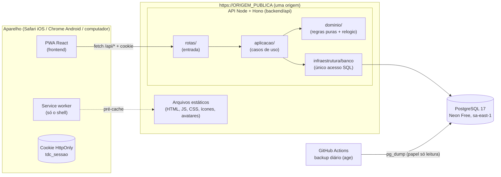
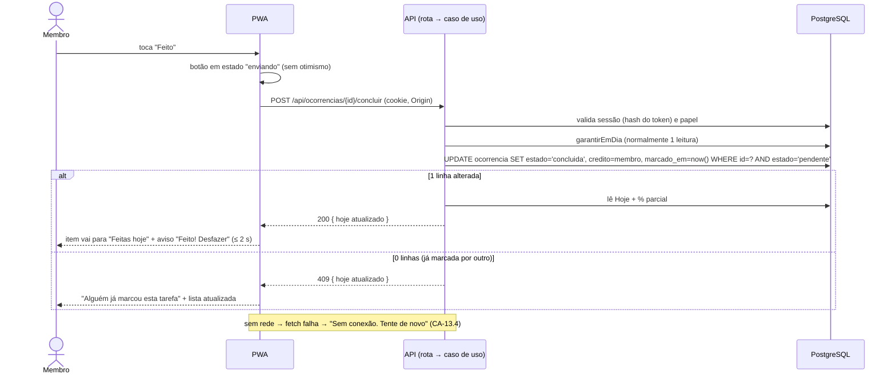
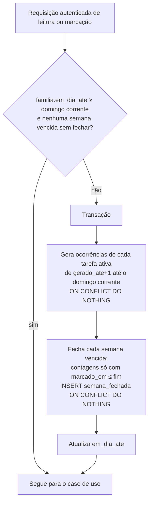
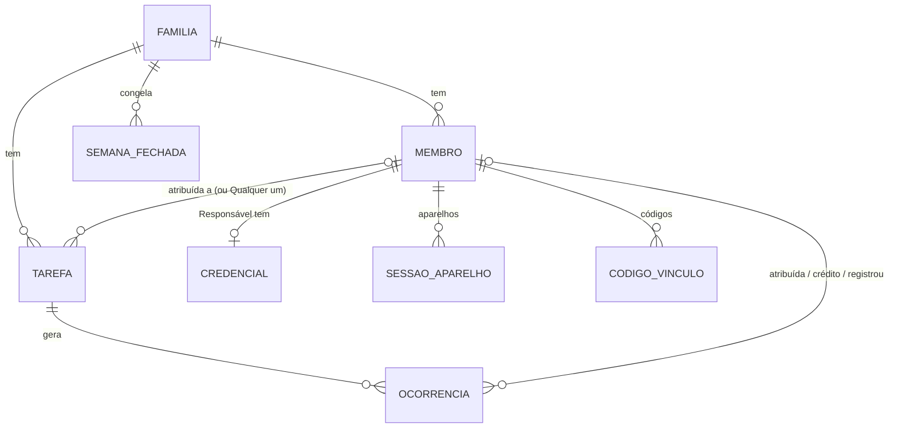

# SDD.md: Tarefas da Casa

> **Status:** **Loop B fechado: aprovado pelo usuário em 2026-10-16** (SDD.md + ADR-001 a ADR-007, UX-SPEC.md e mockup completo em `.md/mockup/`, Artifact https://claude.ai/artifact/N5tuMysXmk8UNQdWmJsy2F). B1 já havia sido aprovado na mesma data. Todos os ADRs (001 a 007) estão aceitos. O documento só muda por novo ADR ou por reabertura registrada.
> **Rodada 2:**
> - respostas a P-01 a P-04, D-02 e D-03 incorporadas;
> - origem definitiva: `https://tarefas-da-casa-ljs.vercel.app` (ADR-006);
> - VM compartilhada do usuário registrada como plano B (ADR-002);
> - custo-alvo: R$ 0;
> - ADR-002, 004, 006 e 007 aceitos.
> **Base:** `.md/PRD-TECNICO.md` (aprovado, decisões D-01 e D-04 a D-14 aceitas), `.md/PRD.md`, `.md/CTO-REVIEW.md` (Gate 1 aprovado com ressalvas).
> **Escopo:** **Fase 1 (MVP)**. As Fases 2 e 3 aparecem só como pontos de extensão (Seção 1.3), sem desenho detalhado.
> **Em aberto:** nenhuma decisão do usuário (ver Anexo A). Ficam para o spike de infraestrutura: a URL exata do projeto Vercel, a região `gru1` e a proteção de previews no Hobby (RT-01).

---

## 1. Visão Geral da Arquitetura

### 1.1 Em uma frase

Um **monólito modular único** (ADR-001) publica, numa **só origem HTTPS**, um **PWA estático** (React + Vite) e uma **API JSON** (Node + Hono) que é a **única fonte da verdade** (RNF-04). Os dados ficam num **PostgreSQL** (Neon Free). A proposta de hospedagem padrão é a **Vercel Hobby** (ADR-002). Não há agendador, fila, worker nem tempo real: as ocorrências e o fechamento da semana são postos em dia **sob demanda**, a cada leitura (ADR-003).

### 1.2 Padrão e justificativa

| Força | Peso | Como o desenho responde |
|---|---|---|
| 1 família, de 4 a 6 pessoas, dezenas de requisições por dia | Volume desprezível | Um processo, um banco, sem cache nem réplica |
| 1 desenvolvedor, ~85 h, histórico de super-engenharia (R-P7) | **Decisivo** | Menos peças possível: sem agendador, sem fila offline, sem estado global no cliente, sem ORM |
| Servidor é a fonte da verdade; marcar exige conexão (RNF-04, D-04) | Decisivo | O aparelho guarda só o shell do app e o cookie de sessão |
| Não pode pausar sem voltar sozinho (RNF-07) | Decisivo | Função sem estado + banco que acorda sozinho + zero agendador (ADR-002, ADR-003) |
| Custo: teto de R$ 10/mês, alvo de R$ 0 depois do D-02 (RNF-14) | Alto | Hospedagem, banco e origem (`*.vercel.app`) gratuitos |
| Sessão no iOS: app instalado isolado do Safari (R-P4) | Alto | Cookie host-only na mesma origem, entrada sempre dentro do app (ADR-004) |

O monólito modular foi escolhido porque o problema é pequeno e coeso: as regras de ocorrência, placar e permissão se tocam o tempo todo. Separar em serviços só traria rede e deploy a mais.

### 1.3 Pontos de extensão para as Fases 2 e 3 (previstos, não projetados)

| Fase | Requisito | Onde entra sem refazer a Fase 1 | O que fica para decidir na fase |
|---|---|---|---|
| 2 | RF-F2-01 Peso 1 a 3 | Coluna `peso` em `tarefa`, copiada para a `ocorrencia` na geração. O cálculo do % é uma função do domínio só. `semana_fechada` já guarda números congelados, então semanas antigas não mudam (RN-09) | Se o % fechado guarda também a soma de pesos |
| 2 | RF-F2-02 Rodízio | A atribuição já é gravada **na ocorrência**, no momento da geração. O gerador (`dominio/geracao`) é o único lugar que decide o atribuído | Efeito de Atrasada e Pulada na vez |
| 2 | RF-F2-03 Recorrência "N dias depois" | `tipo_periodicidade` é um enum, e o gerador escolhe a estratégia pelo tipo | Efeito do pulo na contagem |
| 3 | RF-F3-01 a 03 Push | O service worker já existe (ADR-005). Tabela nova de inscrições por sessão de aparelho | **Agendamento:** o cron do Vercel Hobby é só diário. Saída já disponível: o agendador roda na VM compartilhada do usuário (plano B do ADR-002), sem mudar a origem (RT-07) |

---

## 2. Componentes e Fluxo de Dados

### 2.1 Componentes

| Componente | Onde roda | Responsabilidade | Requisitos |
|---|---|---|---|
| **PWA** (`frontend`) | Navegador (Safari iOS 16.4+, Chrome Android, navegadores de computador) | Telas, navegação, formulários, chamadas à API, estados vazio, carregando, erro e sucesso. Não calcula regra | RF-12, RF-13, RF-14, RF-16, RF-17, RF-18, RF-20, RF-21, RF-22, RF-24, RF-26, RNF-01, RNF-02, RNF-10, RNF-11 |
| **Service worker** | Navegador | Pré-cache do shell. Sem cache de dados. Sem rede → o app abre e mostra "Sem conexão" | RF-23, RNF-10 |
| **API HTTP** (`backend/api`, entrada `rotas`) | Função Node (Vercel) ou processo Node | Autenticação da sessão, validação de entrada, autorização por papel, chamada dos casos de uso, cabeçalhos de segurança | Todos os RF |
| **Identidade e acesso** (contexto `acesso`) | Dentro da API | Família, membros, credenciais, códigos de vínculo, sessões de aparelho, limites de tentativa | RF-01 a RF-08, RN-16, RN-18, RN-20, RN-21 |
| **Rotina** (contexto `rotina`) | Dentro da API | Tarefas, geração de ocorrências, marcação (concluir, pular, desfazer), pendências antigas | RF-09 a RF-17, RF-25, RN-02 a RN-07, RN-11 a RN-15, RN-19 |
| **Placar** (contexto `placar`) | Dentro da API | % parcial, fechamento e congelamento, histórico, contribuições, atividade, painel | RF-18 a RF-22, RF-26, RN-08 a RN-10, RN-17 |
| **Relógio** (`dominio/relogio`) | Dentro da API | "Hoje", início e fim de semana, atraso em dias, tudo em `America/Sao_Paulo` | RNF-15, RN-01, RN-04 |
| **Módulo de dados** (`infraestrutura/banco`) | Dentro da API | **Único** que fala SQL. Expõe funções de consulta e de gravação, nunca a conexão | RNF-04 |
| **PostgreSQL** (Neon Free) | Gerenciado | Persistência | RNF-04, RNF-07 |
| **Backup** (GitHub Actions) | Fora do app | `pg_dump` diário criptografado (ADR-007) | RNF-13 |
| **Scripts de operação** (`backend/api/scripts`) | Máquina do desenvolvedor | Migrações, redefinir senha (F6), conferência de ambiente | F6, RNF-13 |

**Integrações externas (PRD-TECNICO §5.2), todas como fronteira explícita:**

| Integração | Fronteira | Observação |
|---|---|---|
| Domínio (D-02) | Configuração `ORIGEM_PUBLICA=https://tarefas-da-casa-ljs.vercel.app` | ADR-006. Subdomínio gratuito da Vercel, sem DNS próprio |
| Hospedagem estática com HTTPS | Vercel Hobby, projeto `tarefas-da-casa-ljs` | ADR-002. Manifest e service worker servidos na raiz da origem |
| Back-end + banco | Vercel Functions + Neon | ADR-002. Sem pausa que exija ação humana. Plano B: API e/ou agendador na VM compartilhada do usuário, atrás de um rewrite `/api/*` da própria Vercel (mesma origem) |
| Navegadores-alvo | Manifest + service worker + cookie | ADR-004, ADR-005 |
| Web Push (Fase 3) | Fora da Fase 1 | Seção 1.3 |
| Provedor de e-mail | **Nenhum** | D-11 |
| Analytics e SDKs de terceiros | **Proibidos** | RNF-08. CSP `'self'` |

### 2.2 Diagrama de componentes



### 2.3 Fluxo de dados: marcar uma ocorrência (F3, caminho crítico do RNF-02)



### 2.4 Fluxo de dados: leitura e "pôr em dia" (ADR-003)



### 2.5 Fluxo de dados: vínculo de aparelho (F1)

```mermaid
sequenceDiagram
    actor R as Responsável
    actor C as Criança (app instalado)
    participant API
    participant DB
    R->>API: POST /api/membros/{id}/codigos
    API->>DB: invalida código anterior não usado; grava hash do novo, expira em 10 min
    API-->>R: { codigo: "ABCD-EFGH", expiraEm }
    C->>API: POST /api/entrar/codigo { codigo } (cookie tdc_aparelho)
    API->>DB: confere bloqueio por aparelho e por IP
    API->>DB: UPDATE codigo_vinculo SET usado_em=now() WHERE hash=? AND usado_em IS NULL AND expira_em>now() RETURNING membro
    alt válido
        API->>DB: INSERT sessao_aparelho (hash do token, rótulo)
        API-->>C: Set-Cookie tdc_sessao; 200 { membro, papel }
    else inválido
        API->>DB: incrementa tentativa_falha
        API-->>C: 400 "Código inválido ou expirado..."
    end
```

### 2.6 Contrato da API (nível de recurso)

Todas as rotas ficam sob `/api`. Corpo JSON validado pelos esquemas de `backend/contrato`. Erros num formato só: `{ "erro": "<codigo>", "mensagem": "<texto pt-BR>", "campos"?: {...} }`.

| Grupo | Rotas (método e caminho) | Papel |
|---|---|---|
| Situação | `GET /api/situacao` (existe família? sessão atual? versão); `POST /api/erros` (relato de erro do PWA, Seção 2.7) | Público / sessão |
| Entrada | `POST /api/familia` (criar, com código de instalação), `POST /api/entrar/email`, `POST /api/entrar/codigo`, `POST /api/entrar/codigo/credenciais` (adulto convidado define e-mail e senha), `POST /api/sair` | Público / sessão |
| Membros | `GET /api/membros`, `POST /api/membros`, `PATCH /api/membros/{id}`, `DELETE /api/membros/{id}`, `POST /api/membros/{id}/codigos`, `GET /api/membros/{id}/aparelhos`, `DELETE /api/aparelhos/{id}` | Responsável |
| Tarefas | `GET /api/tarefas`, `POST /api/tarefas`, `PATCH /api/tarefas/{id}`, `POST /api/tarefas/{id}/arquivar`, `POST /api/tarefas/{id}/reativar` | Responsável |
| Hoje | `GET /api/hoje` (seções, % parcial, feitas hoje, pendências antigas agrupadas, com `podePular` e `podeDesfazer` por item) | Membro |
| Marcação | `POST /api/ocorrencias/{id}/concluir` (com `creditoMembroId` opcional, RF-25), `.../pular` (motivo opcional), `.../desfazer`, `POST /api/tarefas/{id}/pendencias-antigas/pular` (RF-17) | Membro, conforme RN-12 e RN-20 |
| Placar | `GET /api/casa`, `GET /api/semanas`, `GET /api/eu/contribuicoes`, `GET /api/atividade` | Membro / Responsável (atividade) |

O PWA usa **só** essas rotas e só os tipos de `backend/contrato`.

**Formato exato das respostas:** os arquivos `.md/mockup/respostas/*.json` (B3, 2026-10-16) são a referência dos esquemas do `@tdc/contrato`. A comparação visual responde o app com eles. Mudar um campo exige mudar o JSON e o mockup juntos.

**Decisões de contrato que vieram do mockup (UX-SPEC §7):**
- **Sem conexão (C-12).** Quando uma chamada `/api/*` falha por rede, o service worker responde `503` com `{"erro":"sem_conexao","mensagem":"…"}`. Sem service worker, o app trata o `TypeError` do fetch do mesmo jeito. As duas situações levam ao estado G1.
- **Sessão provisória do adulto convidado (C-18).** O uso de um código do tipo Responsável cria uma sessão provisória. `GET /api/situacao` devolve `sessao.precisaCriarAcesso: true` até o adulto definir e-mail e senha em `POST /api/entrar/codigo/credenciais`. Enquanto isso, só essas duas rotas aceitam a sessão.
- **Folha de opções com endereço próprio (C-13).** A folha T07 abre por `/?opcoes=<id da ocorrência>`, para poder ser comparada e reaberta.

### 2.7 Registro de erros sem terceiros

- Erro não tratado na API: grava uma linha em `registro_erro` (rota, código, mensagem curta, instante, **sem corpo da requisição nem dado pessoal**) e responde `500` genérico.
- Erro no PWA: `POST /api/erros` com mensagem e pilha truncadas, limitado por sessão.
- Retenção: 30 dias, limpos pela própria rotina `garantirEmDia` uma vez por dia.
- Motivo: o Hobby guarda log de execução por só 1 h (ADR-002), e o RNF-08 proíbe SDK de terceiro.

### Pacotes, pastas e fronteiras

**Convenção de topo:** o repositório tem duas pastas de código, `backend/` e `frontend/`. O pacote de contrato mora dentro de `backend/` como pacote **separado** do servidor.

**Pacotes (pnpm workspaces) e quem depende de quem:**

| Pacote | Caminho | Depende de | Nunca depende de |
|---|---|---|---|
| `@tdc/contrato` | `backend/contrato` | `zod` | Node (`fs`, `crypto`...), `@tdc/api`, banco |
| `@tdc/api` | `backend/api` | `@tdc/contrato`, `hono`, `postgres` | `@tdc/pwa` |
| `@tdc/pwa` | `frontend` | `@tdc/contrato`, `react`, `react-dom`, `react-router`, `vite-plugin-pwa` | `@tdc/api` (**não está nas dependências**, então não tem como importar) |

A fronteira é garantida pela lista de dependências de cada pacote. Uma regra de lint de import entra só como reforço.

**Camadas dentro de `@tdc/api` e direção de import permitida:**

```
rotas/  ──►  aplicacao/  ──►  dominio/
                 │
                 └──────►  infraestrutura/  ──►  dominio/ (só tipos)
```

- `dominio/`: funções puras e tipos. Relógio, geração de datas previstas, cálculo do %, transições de estado (RN-02), permissões (RN-12, RN-20), texto neutro de atraso. **Não importa** nada de fora de `dominio/` (nem `hono`, nem `postgres`).
- `aplicacao/`: casos de uso (`concluirOcorrencia`, `vincularAparelho`, `garantirEmDia`...). Orquestra `dominio` e `infraestrutura`. É o único lugar onde se abre transação (por uma função do módulo de dados).
- `infraestrutura/`: `banco/` (único acesso SQL), `senha.ts` (scrypt), `token.ts` (aleatório e hash), `config.ts` (variáveis de ambiente validadas na partida).
- `rotas/`: um arquivo por grupo da Seção 2.6. Valida a entrada com `@tdc/contrato`, resolve a sessão, chama **um** caso de uso e formata a resposta. **Rota não importa rota**, e rota não importa `infraestrutura/banco`.
- `entradas/`: `vercel.ts` e `servidor-node.ts`, que só montam o app Hono. Nenhuma regra mora aqui.

**Acesso a dados num só lugar:** `backend/api/src/infraestrutura/banco/` é o único módulo que conhece SQL e a conexão `postgres`. Ele exporta funções por agregado (`ocorrencias.marcarConcluida(...)`, `sessoes.buscarPorHash(...)`, `emTransacao(fn)`), nunca o objeto de conexão. Migrações em SQL puro em `backend/api/migracoes/NNN_nome.sql`, aplicadas por `scripts/migrar.ts`, que registra cada uma em `migracao_aplicada`.

**Onde a regra de negócio roda:** só em `@tdc/api/dominio` e `aplicacao`. A resposta de `GET /api/hoje` já traz, por item, `estado` (`pendente` ou `atrasada`), `diasAtraso`, `podePular`, `podeDesfazer`, e no topo `percentual` (inteiro truncado ou `null` com o motivo). A tela só formata texto e decide a disposição.

**No `frontend`:** `paginas/` (finas: leem parâmetros, chamam o gancho, compõem), `componentes/` (um componente exportado por arquivo), `api/` (cliente HTTP tipado e ganchos), `textos/` (todos os rótulos e textos do app num só lugar, para conferir a lista de palavras proibidas da RN-17d), `pwa/` (registro do service worker, detecção de instalação).

**Árvore de pastas alvo:**

```
/
├─ backend/
│  ├─ contrato/          # @tdc/contrato: esquemas zod e tipos de requisição e resposta, limites de campos
│  │  └─ src/
│  └─ api/               # @tdc/api: servidor
│     ├─ src/
│     │  ├─ dominio/        # regras puras: relogio, geracao, placar, permissoes, textos-neutros
│     │  ├─ aplicacao/      # casos de uso por contexto: acesso/, rotina/, placar/, garantir-em-dia.ts
│     │  ├─ infraestrutura/ # banco/ (único SQL), senha.ts, token.ts, config.ts
│     │  ├─ rotas/          # um arquivo por grupo de rotas + middleware de sessão, CSRF e cabeçalhos
│     │  └─ entradas/       # vercel.ts, servidor-node.ts
│     ├─ migracoes/      # NNN_nome.sql
│     ├─ scripts/        # migrar.ts, redefinir-senha.ts, conferir-ambiente.ts
│     └─ test/           # unit (dominio), integração (aplicacao + banco local), apoio/ (fábricas)
├─ frontend/             # @tdc/pwa
│  ├─ public/            # ícones, avatares (SVG), fontes, apple-touch-icon
│  └─ src/
│     ├─ paginas/        # uma pasta por tela do UX-SPEC
│     ├─ componentes/    # componentes reutilizáveis (UX-SPEC §3)
│     ├─ api/            # cliente HTTP tipado + ganchos
│     ├─ textos/         # todos os rótulos pt-BR
│     └─ pwa/            # registro do service worker, detecção de standalone
├─ api/                  # SOMENTE se o provedor exigir: 1 arquivo que reexporta backend/api/src/entradas/vercel.ts
├─ .github/workflows/    # ci.yml, backup.yml
└─ pnpm-workspace.yaml
```

A pasta `api/` na raiz só existe se a Vercel exigir o ponto de entrada ali. O spike de infraestrutura confirma (RT-01).

---

## 3. Stack Tecnológica e Justificativa

| Componente | Tecnologia | Requisito que motiva | Alternativa considerada | Trade-off |
|---|---|---|---|---|
| Linguagem | **TypeScript** em todo o código | Contrato único entre tela e API; um desenvolvedor só | JS puro | Etapa de build a mais, compensada por erro pego cedo |
| Runtime da API | **Node.js 24 LTS** | `crypto.scrypt` nativo (ADR-004); roda na Vercel e numa VM | Workers / Deno | Não roda na borda. Irrelevante para uma família no Brasil |
| Framework HTTP | **Hono 4** | Leve, tipado, o mesmo app roda como função e como processo (portabilidade, ADR-002) | Express, Fastify | Menos conhecido que o Express; a superfície usada é pequena |
| Validação e contrato | **zod** em `@tdc/contrato` | Limites de entrada definidos uma vez e usados nos dois lados (CONVENCOES §8) | Tipos à mão + validação manual | Uma dependência a mais, compartilhada |
| Banco | **PostgreSQL 17 no Neon Free**, `sa-east-1`, 0,25 CU | RNF-04, RNF-07 (acorda sozinho), RNF-14 (R$ 0) | Supabase Free (pausa), SQLite/D1 | Latência de acordar o banco (RT-02); cota de 100 CU-h/mês com folga enorme para uma família |
| Driver | **`postgres` (porsager)**, SQL em tagged templates, `prepare: false` no pooler | Sem ORM (R-P7); SQL legível e parametrizado | Drizzle, Prisma | Sem migração gerada; migrações em SQL à mão (poucas) |
| Migrações | SQL puro + script próprio `migrar.ts` | Poucas tabelas; nenhuma dependência | node-pg-migrate | ~40 linhas de script a manter |
| Hash de senha | **`crypto.scrypt`** (Node) | RNF-09 | argon2 (nativo), bcrypt | Parâmetros escolhidos e documentados por nós |
| Front | **React 19 + Vite + React Router** (ADR-005) | RNF-01, familiaridade do usuário | Preact, Svelte, Next.js | Bundle maior que Preact |
| PWA | **vite-plugin-pwa** (Workbox) | RF-23, RNF-10 | Service worker à mão | Camada a entender quando a atualização falha |
| Estilo | **CSS próprio com variáveis** (`tokens.css` do mockup, copiado sem alterar) | Fidelidade ao mockup; sem dependência | Tailwind, biblioteca de componentes | Componentes feitos à mão (são poucos) |
| QR do endereço (Could) | Biblioteca de QR pequena, sem rede, **só se RF-06 CA-06.3 entrar** | CA-06.3 | Não ter QR | Dependência opcional |
| Testes | **Vitest** (unit e integração com Postgres local em Docker); **Playwright** para 2 ou 3 fluxos de ponta a ponta (vincular, marcar, desfazer) | Regras de data e placar são o coração (RT-03) | Jest | Docker local necessário para integração |
| Hospedagem | **Vercel Hobby** (ADR-002), origem `tarefas-da-casa-ljs.vercel.app` (ADR-006) | RNF-07, RNF-14 | VM compartilhada do usuário (disponível, mantida como plano B), Workers | Latência fria; cron só diário (Fase 3); origem presa à Vercel |
| Backup | **GitHub Actions + `pg_dump` + `age`** (ADR-007) | RNF-13 | Só PITR do Neon | Chave privada com o usuário |
| Gerenciador de pacotes | **pnpm workspaces** | Três pacotes com fronteira por dependência | npm workspaces | Nenhum relevante |

**Custo recorrente estimado (RNF-14):**

| Item | Custo |
|---|---|
| Vercel Hobby | R$ 0 |
| Neon Free | R$ 0 |
| GitHub (repositório privado + Actions) | R$ 0 |
| Domínio (D-02): `tarefas-da-casa-ljs.vercel.app`, subdomínio gratuito da Vercel | R$ 0 |
| VM compartilhada (plano B, só se acionada) | R$ 0 marginal: a VM já é paga pelo usuário para outros apps |
| **Total** | **R$ 0/mês** (abaixo do alvo original de R$ 3,33 e do teto de R$ 10) |

**Nenhuma escolha exige `build-vs-buy` formal:** não há compra.

A dependência de fornecedor com custo de saída tem duas partes:
- **API e banco:** mitigada pela portabilidade da API (ADR-002, item 4), pelo plano B na VM e pelo Postgres padrão.
- **Origem `vercel.app`:** presa à Vercel. Trocar o front-end de provedor custa reinstalar e revincular todos os aparelhos. O usuário aceitou isso no D-02 (ADR-006).

---

## 4. Decisões Arquiteturais (índice de ADRs)

| ADR | Título | Status |
|---|---|---|
| [ADR-001](adr/001-monolito-unico-api-e-pwa-na-mesma-origem.md) | Um monólito único serve a API e o PWA na mesma origem, com o código em `backend/` e `frontend/` e um pacote de contrato próprio | **Aceito** |
| [ADR-002](adr/002-hospedagem-padrao-vercel-hobby-com-postgres-neon-free.md) | A hospedagem é Vercel Hobby (estático + função Node) com PostgreSQL no Neon Free; a VM compartilhada do usuário fica como plano B, atrás da mesma origem | **Aceito** |
| [ADR-003](adr/003-ocorrencias-e-fechamento-de-semana-materializados-sob-demanda-sem-agendador.md) | Ocorrências e fechamento de semana são materializados sob demanda, na própria requisição, sem agendador; o estado Atrasada é derivado da data | **Aceito** |
| [ADR-004](adr/004-sessao-por-aparelho-em-cookie-opaco-e-vinculo-por-codigo-de-uso-unico.md) | A sessão é por aparelho, num cookie opaco HttpOnly validado no servidor; a criança entra por código de uso único e o Responsável por e-mail e senha | **Aceito** |
| [ADR-005](adr/005-pwa-em-react-e-vite-com-service-worker-so-para-o-shell.md) | O PWA é React + Vite, com um service worker que guarda só o "shell" do app e nunca dados nem marcações | **Aceito** |
| [ADR-006](adr/006-dominio-definitivo-e-so-configuracao-e-bloqueia-a-primeira-instalacao-real.md) | A origem definitiva é `https://tarefas-da-casa-ljs.vercel.app`, definida só por configuração (`ORIGEM_PUBLICA`); outros hosts da produção são redirecionados e os previews ficam protegidos | **Aceito** |
| [ADR-007](adr/007-backup-diario-por-pg-dump-criptografado-no-github-actions.md) | O backup é um `pg_dump` diário, criptografado com `age` e guardado como artefato do GitHub Actions por 30 dias | **Aceito** |

- **ADR-002, 004, 006 e 007** foram aceitos na rodada 2, pelas respostas do usuário. A partir daí são imutáveis: mudar uma decisão exige um novo ADR que os substitua.
- **ADR-001, 003 e 005** foram aceitos quando o usuário aprovou o B1, em 2026-10-16.

---

## 5. Modelo de Dados de Alto Nível



| Entidade | Campos principais | Regras que carrega |
|---|---|---|
| `familia` | id, nome, fuso (fixo `America/Sao_Paulo`), `em_dia_ate`, criada_em | **Uma linha só** (restrição no banco, RN-21) |
| `membro` | id, papel (`responsavel`, `crianca`), apelido (1 a 20, único entre ativos), avatar (chave do conjunto fixo), removido_em | Remoção = `removido_em` + apelido e avatar apagados → exibido como "Ex-membro" (RN-16c). Pelo menos 1 Responsável ativo (CA-05.3), conferido no caso de uso |
| `credencial` | membro_id (PK), email (único, minúsculas), senha_hash (scrypt + parâmetros) | Só Responsável. Apagada na remoção do membro |
| `codigo_vinculo` | id, membro_id, tipo, codigo_hash, criado_por, expira_em, usado_em, invalidado_em | RN-18. Linhas com mais de 1 dia são apagadas pela rotina diária |
| `sessao_aparelho` | id, membro_id, token_hash (único), rotulo, criada_em, ultimo_uso_em, revogada_em | RNF-05 (60 dias deslizantes), RF-08 |
| `tentativa_falha` | chave (`email:<hash>`, `aparelho:<id>`, `ip:<ip>`), falhas, janela_inicio, bloqueado_ate | CA-02.3, CA-07.4 |
| `tarefa` | id, nome (1 a 60), tipo_periodicidade (`dias`, `semanal_flexivel`), dias_semana (máscara de 7 bits, ≥ 1 se `dias`), atribuido_membro_id (nulo = "Qualquer um"), criada_em, arquivada_em, `gerado_ate` | RN-13, RN-14, RN-15. Não há exclusão de tarefa, só arquivamento |
| `ocorrencia` | id, tarefa_id, data_prevista, atribuido_membro_id (copiado na geração), estado (`pendente`, `concluida`, `pulada`), credito_membro_id, registrado_por_membro_id, marcado_em, motivo_pulo (≤ 80) | Única por `(tarefa_id, data_prevista)`. `registrado_por_membro_id` = quem tocou (sempre preenchido na marcação; é o "autor" da RN-11); `credito_membro_id` = quem recebe a contribuição (igual ao autor, exceto no RF-25). **Atrasada é derivada** (ADR-003). **Ocorrência marcada nunca é apagada** (base do congelamento). Coerência: `estado='pendente'` ⇔ campos de marcação nulos (CHECK) |
| `semana_fechada` | familia_id, inicio (segunda), previstas, concluidas, puladas, nao_feitas, percentual (inteiro truncado ou nulo), fechada_em | PK `(familia_id, inicio)`. Gravada uma vez, **nunca atualizada** (RN-09). Sem divisão por pessoa |
| `registro_erro` | id, origem (`api`, `pwa`), rota, codigo, mensagem, instante | Retenção de 30 dias |
| `migracao_aplicada` | nome, aplicada_em | Controle das migrações |

**Como as telas de placar se resolvem sem tabela extra:**
- **% parcial (RN-08):** contagem sobre `ocorrencia` da semana corrente com `data_prevista ≤ hoje` ou já marcada.
- **Minhas contribuições (RF-21):** contagem de `ocorrencia` com `estado='concluida'` e `credito_membro_id = eu`, agrupada pela semana de `marcado_em` (RN-10).
- **Atividade da família (RF-22):** contagem de marcações (concluídas + puladas) por `credito_membro_id` e semana de `marcado_em`, nas últimas 12 semanas. Na Pulada, `credito_membro_id` = autor (não há crédito de pontuação, só registro de atividade). No RF-25, a atividade vai para o membro creditado.
- **Painel (RF-26):** % parcial + `semana_fechada` da semana anterior + contagem de concluídas na semana.

---

## 6. Riscos Técnicos e Dívida Técnica Aceita

### 6.1 Riscos e gargalos

| ID | Risco/Gargalo | Componente | Severidade | Mitigação ou plano |
|---|---|---|---|---|
| RT-01 | Ainda não foi provado como publicar a API como função na Vercel a partir de `backend/api`. Faltam confirmar: o ponto de entrada, a região `gru1` no Hobby, a conexão ao pooler do Neon, a **URL exata `tarefas-da-casa-ljs.vercel.app`** e a **proteção de previews** no Hobby | Hospedagem | **Média**: algum atrito é provável, mas o impacto é baixo se for pego cedo | **Spike de infraestrutura no primeiro lote:**<br>(1) criar o projeto `tarefas-da-casa-ljs` e conferir a URL;<br>(2) publicar um "olá mundo" com uma rota que consulta o Neon;<br>(3) medir a latência fria e a quente;<br>(4) conferir o redirect por host e a proteção dos previews.<br>Se o nome não estiver disponível: abrir um BK para o usuário escolher outro **antes de seguir**. Se a latência falhar: abrir um BK para o plano B (VM) |
| RT-02 | **Latência fria** (função parada + Neon acordando + conexão TLS) estoura o RNF-12 (Hoje ≤ 3 s p95) no primeiro acesso do dia | API + banco | **Média**: provável no primeiro acesso; o impacto é de alguns segundos a mais, uma vez por dia | **Mitigação:**<br>- medir no spike (RT-01);<br>- o app mostra o estado "Carregando" já com o shell em cache;<br>- cada requisição faz só a consulta de sessão + `garantirEmDia` + Hoje, sem N+1.<br>**Plano B, disponível:** API na VM compartilhada do usuário, sempre ligada, atrás de um rewrite `/api/*` na Vercel, sem mudar a origem (ADR-002, item 5) |
| RT-03 | **Erro nas regras de data e placar** (virada do dia em SP, semana segunda a domingo, semanal flexível, congelamento tardio, conclusão tardia) | `dominio/relogio`, `dominio/placar`, `garantirEmDia` | **Alta** (é o coração do produto; erro silencioso destrói a confiança no placar, I2) | Funções puras com relógio injetado; testes unitários com os exemplos do RN-08 e casos de borda (domingo 23:59:59, segunda 00:00:00, semana sem tarefas, 30 dias parado, conclusão tardia, desfazer proibido em semana fechada); testes de integração do congelamento calculado "na hora" e "depois" com resultado igual (CA-19.3) |
| RT-04 | iOS apaga o armazenamento do app instalado (R-P5) ou derruba o cookie | Sessão no aparelho | **Baixa** (improvável, segundo a WebKit) | Nada além do cookie fica no aparelho (RNF-04). Recuperação em ≤ 2 min: e-mail e senha ou novo código (F5) |
| RT-05 | **PWA velho em cache conversa com API nova** depois de um deploy | PWA + service worker | **Média** (acontece a cada deploy com mudança de contrato) | Cabeçalho `X-Versao-App` em toda resposta; o app recarrega uma vez se diferir. Mudança de contrato só aditiva dentro da Fase 1 |
| RT-06 | **Dependência de dois planos gratuitos** (Vercel Hobby, Neon Free) que podem mudar de regra | Hospedagem | **Média**: o impacto é alto se acontecer, mas a probabilidade em 12 semanas é baixa | **API e banco:** app portável (ADR-002, item 4), plano B na VM e backup diário (ADR-007).<br>**Origem:** a dependência da Vercel continua (RT-11) |
| RT-07 | **A Fase 3 precisa de agendamento** que o Hobby não oferece (cron só diário, com precisão de 1 h) | Hospedagem (futuro) | **Baixa agora / Média na Fase 3** | **Saída já disponível:** agendador na VM compartilhada do usuário (plano B do ADR-002). A escolha final fica para a abertura da Fase 3. Nada na Fase 1 impede |
| RT-11 | **A origem fica presa à Vercel** (`tarefas-da-casa-ljs.vercel.app`, ADR-006). Ela se perde se a conta ou o projeto forem suspensos, apagados ou renomeados, ou se a Vercel mudar a regra do `vercel.app`. Trocar de provedor do front-end ou adotar um domínio próprio exige reinstalar e revincular todos os aparelhos | Origem | **Média**: o impacto é alto (reinstalar a família inteira), mas a probabilidade é baixa | **Mitigação:**<br>- nunca renomear nem apagar o projeto (regra para o GUARDRAILS);<br>- dados a salvo no Neon e no backup;<br>- procedimento de "nova origem" no `DEPLOY.md`: reinstalar e gerar códigos para todos.<br>Risco aceito pelo usuário no D-02 |
| RT-08 | Ponto único de falha: um único banco e uma única função | Tudo | **Baixa** (uso doméstico tolera horas fora; RNF sem SLA) | Backup diário, restauração ensaiada (ADR-007). Sem redundância, de propósito |
| RT-09 | Bloqueio por IP atinge a casa inteira (mesmo Wi-Fi) se alguém errar o código muitas vezes | Acesso | **Baixa** | Limite alto (30/h) e curto (1 h); o Responsável com sessão ativa não é afetado |
| RT-10 | Concorrência: dois aparelhos marcam a mesma ocorrência ao mesmo tempo | Rotina | **Baixa** | `UPDATE ... WHERE estado='pendente'`: o segundo recebe 409 e a lista atualizada |

**Comparação com os RNF de volume e tempo:** o volume esperado (até ~6 membros, ~20 tarefas, ~150 ocorrências por semana, < 500 requisições por dia) está várias ordens de grandeza abaixo de qualquer limite do Hobby e do Neon Free. O único RNF em risco é o RNF-12 no acesso frio (RT-02).

### 6.2 Dívida técnica aceita

| Dívida Técnica Aceita | Motivo | Condição de revisão |
|---|---|---|
| Sem tempo real entre aparelhos (a lista atualiza ao abrir, ao voltar ao app e após marcar) | RF-18 aceita "na próxima vez que a tela for exibida". Menos peças | Se a família reclamar de marcar algo já feito por outro (409 frequente) |
| Sem marcação offline | D-04 | Backlog, sem fase |
| Sem redundância nem monitor de disponibilidade | Uso familiar, sem SLA | Se houver queda percebida mais de 1 vez por mês |
| Log de erro em tabela própria, sem ferramenta de observabilidade | RNF-08 e custo | Se um erro escapar sem rastro duas vezes |
| `garantirEmDia` roda em toda leitura | Elimina o agendador (ADR-003) | Se a medição mostrar > 300 ms por requisição |
| Criança e Responsável no mesmo bundle (sem separar o código de gestão) | Bundle pequeno; uma build só | Se o bundle passar de ~300 kB comprimido |

### Troca de dados em produção

| Fluxo que substitui dados | Janela de inconsistência | Como fica atômico | Como volta atrás |
|---|---|---|---|
| **Migração de schema** (`migrar.ts` no deploy) | Entre aplicar a migração e a nova função entrar no ar, a versão antiga da API lê o schema novo | Cada arquivo de migração roda numa transação (Postgres tem DDL transacional). Regra **expandir e depois contrair**: coluna nova nasce opcional; remoção só num deploy posterior, quando nenhuma versão em uso lê a coluna | Antes de migrar, o deploy dispara o workflow de backup (ADR-007) e cria um **branch do Neon** (cópia instantânea). Falha no meio → a transação desfaz. Erro descoberto depois → restaurar o branch ou o dump (< 30 min) |
| **Regeneração de ocorrências** ao editar tarefa (RN-14) | Nenhuma visível: apagar as futuras não marcadas e gerar as novas acontece na mesma transação | Transação única no caso de uso | Desfazer = editar de novo. Ocorrências marcadas nunca são tocadas |
| **Arquivamento** (RN-15) e **pular todas as pendências antigas** (RF-17) | Nenhuma: transação única | Transação única | Reativar a tarefa / desfazer não se aplica a período fechado (RN-11), por regra de negócio |
| **Fechamento de semana** (`garantirEmDia`) | Nenhuma: a linha nasce completa ou não nasce | `INSERT ... ON CONFLICT DO NOTHING` na mesma transação da geração | Não volta atrás, por regra (RN-09). Erro de cálculo detectado = correção por script registrado no `DEPLOY.md`, com aprovação do usuário |
| **Remoção de membro** (RN-16) | Nenhuma: reatribuição, revogação de aparelhos e anonimização numa transação | Transação única | Não volta (o apelido foi apagado, por minimização). A tela pede confirmação explícita |
| **Restauração de backup** | O app fica fora do ar durante a troca da `DATABASE_URL` | Restaura num banco novo e troca a variável de uma vez | Voltar a variável para o banco anterior |

---

## 7. Requisitos de Segurança e Compliance

> Requisitos de arquitetura. A verificação tática (SAST, DAST, dependências, cabeçalhos) é do Validador.

### Autenticação
- **Responsável:** e-mail + senha (≥ 8 caracteres). Hash `scrypt` com sal aleatório de 16 bytes, parâmetros mínimos N=2^15, r=8, p=1, gravados junto do hash. Comparação em tempo constante. Mensagem genérica em erro (CA-02.2). 5 falhas seguidas por e-mail → 15 min de bloqueio (CA-02.3).
- **Criança e adulto convidado:** código de vínculo (RN-18): 8 caracteres de alfabeto de 31 símbolos, gerado com `crypto.randomInt`, guardado só como hash SHA-256, uso único atômico, 10 min de validade, invalidado ao gerar outro. 5 falhas seguidas por aparelho → 10 min (CA-07.4); 30 falhas por IP por hora → 1 h.
- **Sessão de aparelho:** token de 32 bytes de `crypto.randomBytes`, só o hash no banco. Cookie `tdc_sessao`: `HttpOnly; Secure; SameSite=Lax; Path=/`, sem `Domain`. Validade deslizante de 60 dias no servidor (RNF-05). Revogável por Responsável (RF-08) e pelo próprio aparelho (Sair).
- **Criar família:** exige o `CODIGO_INSTALACAO` da variável de ambiente e só funciona sem família existente (ADR-004, item 5).
- **Serviço a serviço:** a API fala só com o banco, por TLS (`sslmode=require` ou mais forte) e com um papel sem DDL. O backup usa um papel **só de leitura**. As migrações usam o papel dono, só no deploy. Nenhuma credencial no repositório (`gitleaks` no CI).

### Autorização
Modelo **RBAC simples com dois papéis + regra de posse**, aplicado no caso de uso (não na tela):

| Ação | Responsável | Criança | Regra |
|---|---|---|---|
| Ver Hoje, Casa, Semanas anteriores, Minhas contribuições | Sim | Sim | RN-20 |
| Concluir qualquer ocorrência | Sim | Sim | RN-12, RN-19 |
| Concluir em nome de outro (RF-25) | Sim | Não | RF-25 |
| Pular | Qualquer ocorrência | Só as atribuídas a ela ou a "Qualquer um" | RN-12 |
| Desfazer | Qualquer marcação do período aberto | Só as próprias, do período aberto | RN-11 |
| Pular todas as pendências antigas de uma tarefa | Sim | Não | CA-17.2 |
| Cadastrar, editar, arquivar, remover (tarefas e membros); gerar código; ver e revogar aparelhos; ver Atividade da família | Sim | Não | RN-20, RNF-11 |
| Sair do próprio aparelho | Sim | Sim | CA-08.3 |

- Toda rota resolve o membro pela sessão. **Nenhum id de membro do corpo da requisição é usado como "quem está agindo".**
- A tela esconde o que o papel não pode (CA-14.4), mas a API **recusa com 403** mesmo assim.
- **RN-17 é requisito de segurança de dados também:** as respostas de `GET /api/hoje` (seção "Da casa"), `/api/casa` e `/api/semanas` **não contêm** o apelido do atribuído nem de quem não fez. A ausência é garantida no formato da resposta (`@tdc/contrato`), não só na tela.

### Criptografia
- **Em trânsito:**
  - HTTPS em toda a origem. O TLD `.app` já está na pré-carga de HSTS dos navegadores.
  - Cabeçalho próprio `Strict-Transport-Security: max-age=31536000`, **sem** `includeSubDomains` nem `preload`, porque não controlamos o domínio-pai `vercel.app`.
  - Certificado TLS gerenciado pela Vercel.
  - Banco só por TLS.
- **Em repouso:** o Neon criptografa o armazenamento. Segredos de autenticação nunca em claro (senha em scrypt, tokens e códigos em SHA-256). Backup criptografado com `age` (ADR-007).
- **Dados pessoais (RNF-08, LGPD art. 14):** criança = apelido + avatar do conjunto fixo; adulto = apelido + e-mail + hash. Rótulo do aparelho guardado já resumido ("iPhone · Safari"), sem o user-agent bruto. O IP aparece só como chave da `tentativa_falha` e é apagado quando a janela expira. Nenhuma localização, foto, telefone ou data de nascimento existe no schema.

### Isolamento Multi-Tenant
**Não aplicável: sistema single-tenant.** Uma família por instalação (RN-21, D-13), garantida por restrição no banco. Se um dia comercializar, isolamento por `familia_id` com RLS precisa de novo ADR e nova análise jurídica (PRD-TECNICO R-P6).

### Superfície de Exposição
- **Exposto à internet:** só a origem `https://tarefas-da-casa-ljs.vercel.app` (estático + `/api/*`).
  - Os outros hosts do deploy de produção (URL por deploy, URL de branch) redirecionam para ela com `308`.
  - Os previews ficam atrás da proteção de deploy da Vercel e usam um branch separado do Neon (ADR-006).
  - Como `vercel.app` está na Public Suffix List, cookies de outros projetos ou previews `*.vercel.app` nunca chegam à origem. O cookie de sessão é host-only.
  - O endereço da origem é público e previsível. Por isso o "Criar família" exige o código de instalação (ADR-004). O banco é acessível pela internet só com credencial (o Neon Free não tem lista de IPs), e as senhas dos papéis são aleatórias, com ≥ 32 caracteres.
- **Cabeçalhos obrigatórios em toda resposta:** `Content-Security-Policy: default-src 'self'; img-src 'self' data:; object-src 'none'; base-uri 'none'; frame-ancestors 'none'`, `Strict-Transport-Security`, `X-Content-Type-Options: nosniff`, `Referrer-Policy: no-referrer`, `Permissions-Policy` desligando câmera, microfone e geolocalização.
- **CSRF:** `SameSite=Lax` + `Origin` igual a `ORIGEM_PUBLICA` em todo método que altera dado + `Content-Type: application/json`.
- **Entrada:** todo campo validado no servidor pelos esquemas do contrato (tamanho, formato de id, enum, faixa). SQL sempre parametrizado (tagged templates).
- **Sem terceiros (RNF-08):** CSP `'self'` impede, na prática, qualquer script, fonte ou pixel externo. O CI falha se o bundle referenciar domínio externo.
- **Rotas públicas:** só `GET /api/situacao`, `POST /api/familia` (com código de instalação), `POST /api/entrar/*` (com limite de tentativas) e os arquivos estáticos.

---

## Anexo A. Decisões do Usuário (rodada 2, 2026-10-16)

> Anexo fora das 7 seções fixas, mantido como registro. **Nenhuma pergunta em aberto.**
>
> - [x] **B1 aprovado pelo usuário em 2026-10-16:** SDD.md, ADR-001 a ADR-007 e o rascunho do UX-SPEC.md.
> - [x] **Loop B fechado em 2026-10-16:** o usuário aprovou o SDD.md + ADRs, o UX-SPEC.md e o mockup completo (`.md/mockup/`, Artifact https://claude.ai/artifact/N5tuMysXmk8UNQdWmJsy2F). Segue o Loop C (TASK.md + GUARDRAILS.md).

| ID | Pergunta | Resposta do usuário | Onde foi aplicada |
|---|---|---|---|
| **D-02** | Domínio definitivo | `tarefas-da-casa-ljs.vercel.app`, subdomínio gratuito da Vercel | ADR-006 (Aceito, com as implicações no item 7), Seções 2.1, 3, 6 (RT-01, RT-11) e 7 |
| **D-03** | Data-limite da Fase 1 | O usuário é indiferente. **Referência flexível: 8 semanas depois da aprovação do `/definir`.** Serve para calibrar o TASK.md e a lista de corte, não é um prazo rígido | TASK.md (riscos de prazo), quando for produzido |
| **P-01** | A VM compartilhada existe? | Existe e aceita mais um app, mas **o usuário mantém Vercel Hobby + Neon Free**. A VM fica como plano B para o RT-02 e o RT-07, sem ADR próprio por enquanto | ADR-002 (Aceito, item 5), Seções 1.3, 2.1, 3 e 6 |
| **P-02** | Código de instalação no "Criar família" | Aceito | ADR-004 (Aceito), UX-SPEC §7 C-01 |
| **P-03** | Backup como artefato do GitHub, com o usuário guardando a chave `age` | Aceito | ADR-007 (Aceito) |
| **P-04** | Contas no GitHub, na Vercel e no Neon | O usuário já tem as três | Pré-requisito do spike atendido |

**Ação pendente do usuário (não é pergunta):** criar o projeto Vercel `tarefas-da-casa-ljs` e confirmar que a URL de produção é exatamente essa. Isso reserva o nome. Se o nome não estiver disponível, a escolha do domínio volta ao usuário antes de qualquer outra tarefa (RT-01).
