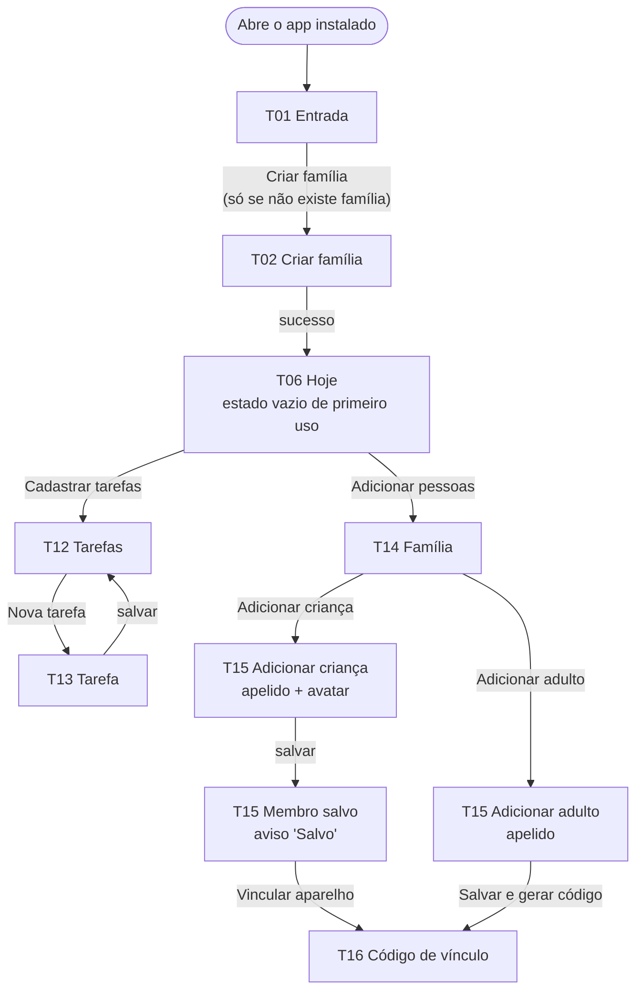
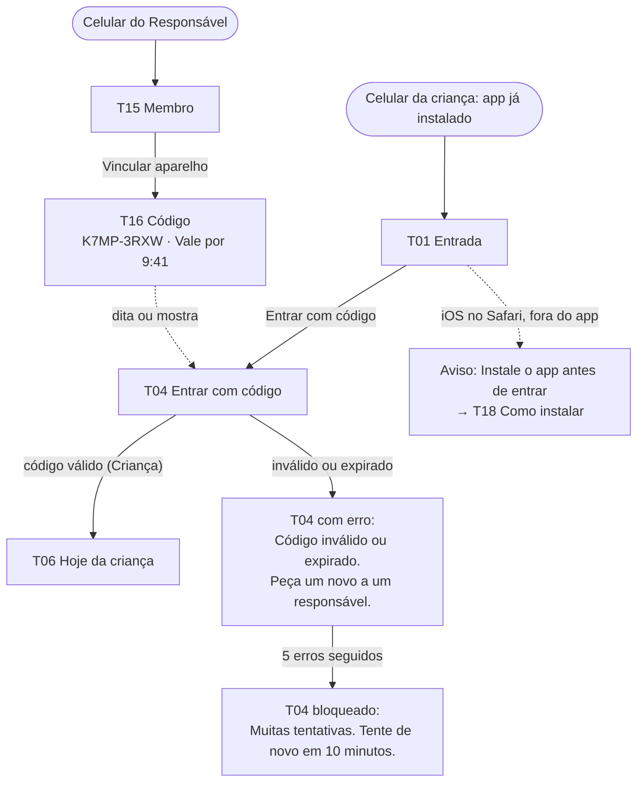
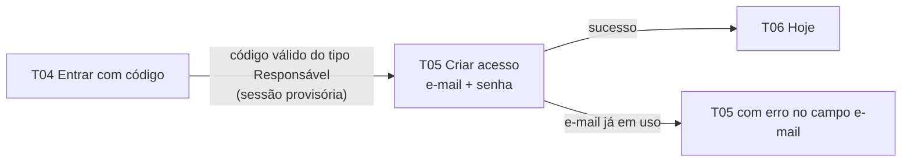
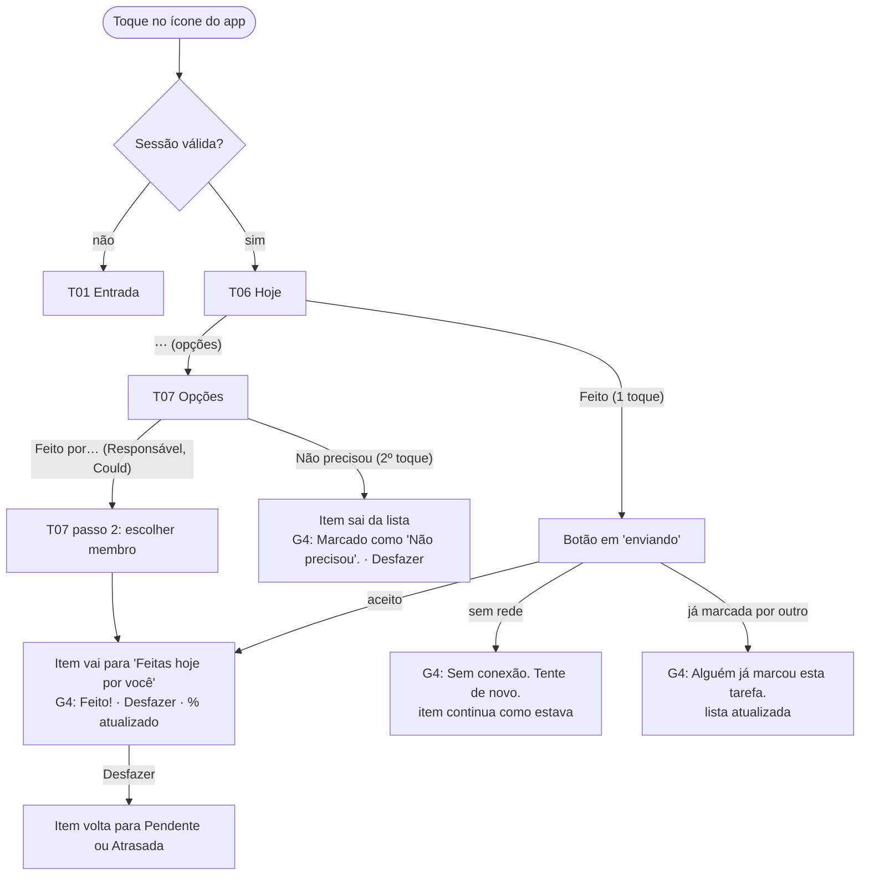
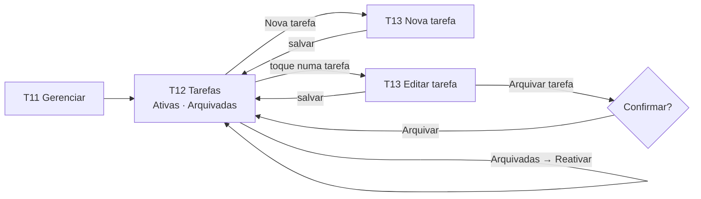
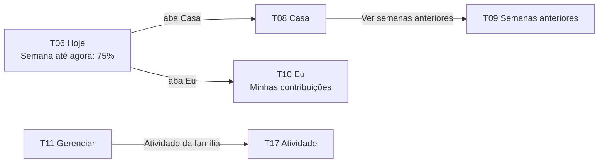
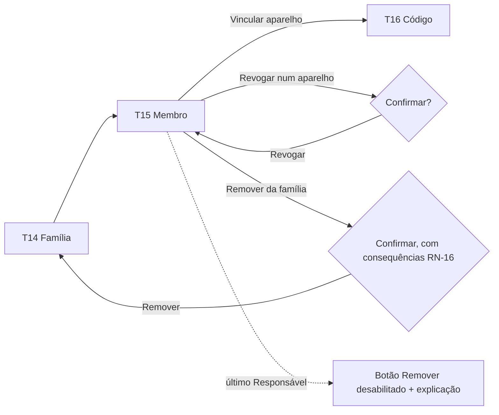
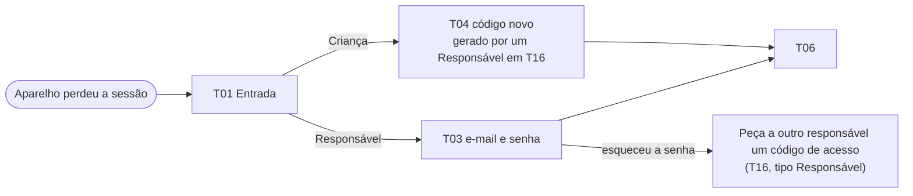

# UX-SPEC.md: Tarefas da Casa

> **Status:** **aprovado pelo usuário em 2026-10-16** (fechamento do Loop B do `/definir`), junto com o SDD.md, os ADRs e o mockup completo da direção B em `.md/mockup/`.
> **Base:** `.md/PRD-TECNICO.md` (aprovado), `.md/SDD.md` (B1 aprovado).
> **Prioridade:** cada tela e elemento leva a prioridade do requisito de origem (Must, Should, Could), para que a lista de corte do PRD (Seção 5) possa ser aplicada sem redesenhar.

---

## 0. Mockup Aprovado

- **Direção escolhida (B2, 2026-10-16):** **B, Lápis de Cor**, pura, sem mistura. Galeria das direções: https://claude.ai/artifact/KvzAXEPVn8akWmvYxBVkJM
- **Direções descartadas:** A (Varal) e C (Caderno), em `.md/mockup/direcoes/a-varal/` e `.md/mockup/direcoes/c-caderno/`. **Não usar como referência.** A pasta `.md/mockup/direcoes/b-lapis-de-cor/` também fica só como histórico; a referência é `.md/mockup/`.
- **Mockup completo (B3):** `.md/mockup/index.html` (galeria). Link do Artifact: https://claude.ai/artifact/N5tuMysXmk8UNQdWmJsy2F (publicado em 2026-10-16, com as fontes woff2 já baixadas em `fontes/`).
- **Aprovação:** **mockup completo aprovado pelo usuário em 2026-10-16**, no fechamento do Loop B. A partir daqui, é a fonte de verdade da aparência: mudança visual começa no mockup (e no `telas.json`/`respostas/`), nunca direto no código.
- **Arquivos:**
  - `tokens.css`: única fonte de valores visuais;
  - `base.css`: componentes;
  - `fontes/`: Baloo 2 e Nunito em woff2, com `baixar-fontes.ps1`/`.sh` e licença OFL;
  - `avatares/`: 12 avatares + "Ex-membro";
  - `logo.svg`;
  - `telas/`: 89 páginas;
  - `respostas/`: 39 JSON no formato do contrato;
  - `dados.json`;
  - `telas.json`.
- **Variante calma das telas de gestão (T11 a T17):** ver a regra na §3.

**Regra de precedência:** Para aparência (cor, tipografia, espaçamento, disposição) vale o mockup; para comportamento, dados e acessibilidade vale este documento. Um conflito entre os dois é defeito do planejamento: corrija o mockup ou o texto antes de aprovar; nunca deixe para o Executor decidir.

**Como a fidelidade é verificada:**
- **Automático:** `.claude/scripts/comparar-visual.mjs` com `.md/mockup/telas.json`, limite de **1%** de pixels divergentes por comparação. São 62 estados alcançáveis abrindo a rota, quase todos nos dois tamanhos: 120 comparações.
- **Manual:** os 27 estados que dependem de interação, do modo instalado ou do host estão na chave `manuais` do `telas.json`. O Validador confere cada um à mão, nos dois tamanhos (§7, C-13).

**Tela × página × rota × tamanhos** (igual ao `telas.json`; todas as páginas ficam em `.md/mockup/telas/`):

| Tela | Página do mockup por estado | Rota no app | Tamanhos |
|---|---|---|---|
| T01 Entrada | `t01-entrada--sucesso`, `--primeiro-uso`, `--aviso-instalacao` (UA iPhone), `--carregando`, `--erro` | `/entrar` | celular e PC (aviso: celular) |
| G2 Sessão encerrada | `t01-entrada--sessao-encerrada` | `/` → `/entrar` | celular e PC |
| T02 Criar família | `t02-criar-familia--sucesso`; manuais: `--carregando`, `--erro` | `/criar-familia` | celular e PC |
| T03 Entrar com e-mail | `t03-entrar-email--sucesso`; manuais: `--carregando`, `--erro`, `--bloqueado` | `/entrar/email` | celular e PC |
| T04 Entrar com código | `t04-entrar-codigo--sucesso`; manuais: `--carregando`, `--erro`, `--bloqueado` | `/entrar/codigo` | celular e PC |
| T05 Criar acesso | `t05-criar-acesso--sucesso`; manuais: `--carregando`, `--erro` | `/entrar/codigo/acesso` | celular e PC |
| T06 Hoje | `t06-hoje--sucesso` (Bia), `--vazio`, `--vazio-primeiro-uso` (Leo), `--vazio-sem-tarefas-crianca`, `--carregando`, `--erro`, `--erro-servidor`; manuais: `--sucesso-responsavel`, `--erro-acao`, `--conflito`, `--confirmar-marcar-todas` | `/` | celular e PC |
| T07 Opções | `t07-opcoes--sucesso`, `--sucesso-responsavel` (recorte `.folha`); manuais: `--feito-por`, `--carregando`, `--erro` | `/?opcoes=<id da ocorrência>` | celular e PC |
| T08 Casa | `t08-casa--sucesso`, `--vazio`, `--carregando`, `--erro` | `/casa` | celular e PC |
| T09 Semanas anteriores | `t09-semanas--sucesso`, `--vazio`, `--carregando`, `--erro` | `/casa/semanas` | celular e PC |
| T10 Eu | `t10-eu--sucesso`, `--carregando`, `--erro`; manuais: `--confirmar-sair`, `--confirmar-sair-responsavel` | `/eu` | celular e PC |
| T11 Gerenciar | `t11-gerenciar--sucesso`, `--carregando`, `--erro` | `/gerenciar` | celular e PC |
| T12 Tarefas | `t12-tarefas--sucesso`, `--arquivadas`, `--vazio`, `--arquivadas-vazio`, `--carregando`, `--erro` | `/gerenciar/tarefas` e `?filtro=arquivadas` | celular e PC |
| T13 Tarefa | `t13-tarefa--sucesso` (nova), `--edicao`, `--carregando`; manuais: `--erro`, `--confirmar-arquivar` | `/gerenciar/tarefas/nova`, `/gerenciar/tarefas/:id` | celular e PC |
| T14 Família | `t14-familia--sucesso`, `--carregando`, `--erro` | `/gerenciar/familia` | celular e PC |
| T15 Membro | `t15-membro--sucesso`, `--nova-crianca`, `--novo-adulto`, `--vazio`, `--carregando`, `--ultimo-responsavel`; manuais: `--erro`, `--confirmar-remover`, `--confirmar-revogar` | `/gerenciar/familia/:id`, `/gerenciar/familia/novo?papel=crianca\|responsavel` | celular e PC |
| T16 Código | `t16-codigo--sucesso`, `--expirado`, `--carregando`, `--erro` | `/gerenciar/familia/:id/codigo` | celular e PC |
| T17 Atividade | `t17-atividade--sucesso`, `--vazio`, `--carregando`, `--erro` | `/gerenciar/atividade` | celular e PC |
| T18 Como instalar | `t18-instalar--sucesso` (UA iPhone), `--android` (UA Android), `--computador`; manual: `--instalado` | `/instalar` | iOS e Android: celular; computador: PC |
| G3 Ambiente de teste | `g3-ambiente-teste` (manual) | qualquer, fora da origem definitiva | celular e PC |
| G4 Avisos | `g4-avisos` (catálogo, manual) | — | celular e PC |

---

## 1. Fluxos de Tela

### 1.1 Inventário de telas

| ID | Tela | Rota | Quem vê | Prioridade | Requisitos |
|---|---|---|---|---|---|
| T01 | Entrada | `/entrar` | Sem sessão | Must | RF-01 (CA-01.3), RF-02, RF-07, RNF-05, F5 |
| T02 | Criar família | `/criar-familia` | Sem sessão, sem família | Must | RF-01 |
| T03 | Entrar com e-mail | `/entrar/email` | Sem sessão | Must | RF-02 |
| T04 | Entrar com código | `/entrar/codigo` | Sem sessão | Must | RF-07, RF-03 (CA-03.2) |
| T05 | Criar acesso do adulto | `/entrar/codigo/acesso` | Adulto com sessão provisória criada pelo código do tipo Responsável (`precisaCriarAcesso`) | Must | RF-03 |
| T06 | Hoje | `/` | Todos | Must | RF-12, RF-13, RF-14, RF-15, RF-16 (Should), RF-17 (Should), RF-18 |
| T07 | Opções da ocorrência (folha inferior) | `/?opcoes=<id>` (sobre T06) | Todos (conteúdo varia por papel) | Must (pular); Could (Feito por…) | RF-14, RF-25 |
| T08 | Casa | `/casa` | Todos | Must | RF-26, RF-18, RF-19 |
| T09 | Semanas anteriores | `/casa/semanas` | Todos | Should (H13, 1º a cortar) | RF-20 |
| T10 | Eu | `/eu` | Todos | Must | RF-21, RF-08 (CA-08.3, Sair), RF-24 (link, Could) |
| T11 | Gerenciar | `/gerenciar` | Responsável | Must | Ponto de acesso a T12, T14, T17 |
| T12 | Tarefas | `/gerenciar/tarefas` (`?filtro=arquivadas`) | Responsável | Must | RF-09, RF-10 |
| T13 | Tarefa (criar ou editar) | `/gerenciar/tarefas/nova`, `/gerenciar/tarefas/:id` | Responsável | Must; semanal flexível = Should (H11) | RF-09, RF-10, RN-14, RN-15 |
| T14 | Família | `/gerenciar/familia` | Responsável | Must | RF-03, RF-04, RF-05 |
| T15 | Membro (criar ou editar) | `/gerenciar/familia/novo?papel=…`, `/gerenciar/familia/:id` | Responsável | Must | RF-03, RF-04, RF-05, RF-08, RN-16 |
| T16 | Código de vínculo | `/gerenciar/familia/:id/codigo` | Responsável | Must; QR = Could (fora do mockup, C-15) | RF-06 |
| T17 | Atividade da família | `/gerenciar/atividade` | Responsável | Should (H9) | RF-22 |
| T18 | Como instalar | `/instalar` | Todos (no navegador, fora do app instalado) | Could (H14) | RF-24 |

**Elementos globais (não são telas):**

| ID | Elemento | Onde | Prioridade | Requisitos |
|---|---|---|---|---|
| G1 | Estado "Sem conexão" | Toda tela que busca dados; toda ação (como aviso) | Must | RNF-10, CA-13.4 |
| G2 | Sessão encerrada (401) → volta a T01 com aviso | Toda tela autenticada | Must | CA-08.2 |
| G3 | Faixa "AMBIENTE DE TESTE" | Topo de toda tela fora da origem definitiva | Must | ADR-006 |
| G4 | Aviso (snackbar), com ou sem "Desfazer" | Depois de ações (catálogo em `g4-avisos`) | Should (o desfazer é H10) | RF-13, RF-16 |
| G5 | Barra de navegação | Toda tela autenticada | Must | — |

**Navegação principal (G5):**
- **Criança:** Hoje · Casa · Eu (3 abas).
- **Responsável:** Hoje · Casa · Gerenciar · Eu (4 abas).
- No celular, barra inferior. No computador (≥ 1024 px), barra lateral com o nome do app (§6).

### 1.2 FX1: Primeiro uso do Responsável (configuração inicial)

### 1.3 FX2: Vincular o celular da criança (F1 do PRD-TECNICO)

### 1.4 FX3: Adulto convidado

### 1.5 FX4: Marcar, pular e desfazer (caminho crítico, RNF-02)

### 1.6 FX5: Cadastrar, editar e arquivar tarefa

### 1.7 FX6: Placar, histórico e contribuições

### 1.8 FX7: Gerenciar membros e aparelhos

### 1.9 FX8: Recuperação (F5, F6)

### 1.10 Rastreabilidade: fluxo do PRD-TECNICO → telas

| Fluxo do PRD-TECNICO | Telas |
|---|---|
| F1 Configuração inicial e vínculo | T01, T02, T06, T14, T15, T16, T04, T05 (FX1, FX2, FX3) |
| F2 Ciclo de vida da ocorrência | T06, T07 (FX4) |
| F3 Marcar uma tarefa | T06, T07, G1, G4 (FX4) |
| F4 Fechamento da semana | T06 (pendências antigas), T08, T09 (FX6). O fechamento em si não tem tela: acontece no servidor (ADR-003) |
| F5 Recuperação | T01, T03, T04, T16 (FX8) |
| F6 Responsável sem acesso | T03 (nota de ajuda), T16 com código do tipo Responsável, T05 (FX8) |

---

## 2. Wireframes / Descrição de Layout por Tela

**Convenções:**
- O texto entre aspas é o texto exato, igual ao do mockup.
- Todo botão de ação principal tem **ícone + texto** (RNF-11).
- **Ordem dentro de um campo:**
  - instrução (ex.: T04) acima do campo;
  - o erro logo abaixo do campo;
  - regra (ex.: "Pelo menos 8 caracteres.") abaixo do erro.
- **Formulário com erro:** alerta "Confira os campos marcados." no topo, e cada campo com o seu erro.
- **Botão enviando:** mantém o rótulo e troca o ícone pelo indicador (`aria-busy`). Os campos ficam só leitura.
- **Confirmações:**
  - diálogo centralizado, com título em pergunta, texto da consequência, ação e "Cancelar";
  - ação de perigo ("Remover", "Revogar", "Sair") em vermelho de erro; as demais na cor primária.

### T01 Entrada
- **Topo:** logotipo e "Tarefas da Casa".
- **Botões grandes:**
  - "Entrar com código" (principal), com o subtexto "Para crianças e para quem recebeu um código";
  - "Entrar com e-mail", com o subtexto "Para responsáveis";
  - "Criar família" (terciário, com ícone +), **só quando ainda não existe família** (CA-01.3).
- **Aviso de instalação** (iOS no Safari, fora do app instalado), em bloco informativo acima dos botões:
  - "Instale o app antes de entrar. No iPhone, a entrada feita no Safari não vale para o app da Tela de Início.";
  - link "Ver como instalar";
  - no rodapé, o link "Como instalar o app" (T18, Could).
  - Os botões continuam disponíveis (§7, C-04).
- **G2:** bloco informativo "Sua sessão foi encerrada neste aparelho. Entre de novo.", acima dos botões.

### T02 Criar família
- **Título:** "Criar família", com o botão voltar.
- **Campos:**
  - "Nome da família";
  - "Seu apelido";
  - "E-mail";
  - "Senha", com o botão "Mostrar senha" e a regra "Pelo menos 8 caracteres.";
  - "Código de instalação", com a ajuda "Está nas configurações do servidor. Só é pedido desta vez.".
- **Botão:** "Criar família".
- **Erros (CA-01.4):**
  - "Digite um e-mail válido, como nome@exemplo.com.";
  - "A senha precisa ter pelo menos 8 caracteres.";
  - "Código de instalação incorreto.".

### T03 Entrar com e-mail
- **Título:** "Entrar com e-mail".
- **Campos:** "E-mail" e "Senha" (com "Mostrar senha").
- **Botão:** "Entrar".
- **Nota de ajuda (D-11):** "Esqueceu a senha? Peça a outro responsável um código de acesso."
- **Erro (alerta, CA-02.2):** "E-mail ou senha incorretos."
- **Bloqueio (alerta, botão desabilitado):** "Muitas tentativas com este e-mail. Tente de novo em 15 minutos."

### T04 Entrar com código
- **Título:** "Entrar com código".
- **Campo:**
  - rótulo "Código", com a instrução "Peça o código a um responsável." acima dele;
  - campo único, grande, em maiúsculas automáticas, sem corretor, aceitando colar;
  - mostra o código no formato `XXXX-XXXX`.
- **Botão:** "Entrar", desabilitado até haver 8 caracteres.
- **Erro (abaixo do campo, CA-07.3):** "Código inválido ou expirado. Peça um novo a um responsável."
- **Bloqueio (alerta, CA-07.4):** "Muitas tentativas. Tente de novo em 10 minutos."
- Se o código for do tipo Responsável, vai para T05.

### T05 Criar acesso do adulto
- **Topo:** avatar + "Olá, {apelido}! Crie seu acesso".
- **Campos:** "E-mail" e "Senha" (com "Mostrar senha" e "Pelo menos 8 caracteres.").
- **Botão:** "Salvar e entrar".
- **Erro (CA-03.3):** "Este e-mail já está em uso."

### T06 Hoje (tela inicial)
De cima para baixo:
1. **Cabeçalho:** "Hoje" + a data ("sexta, 16 de outubro") + o avatar do membro.
2. **Faixa do placar (RF-18), amarela:** "Semana até agora:" + o número grande ("75%") + a barra.
   - Denominador zero: "Sem tarefas previstas ainda", sem número e sem barra (CA-18.3).
3. **"Para você":** ocorrências atribuídas ao membro.
   - Item: nome; rótulo de tempo (tabela abaixo); "⋯" (nome acessível "Mais opções para {tarefa}"); "Feito" (ícone ✓ + texto, à direita).
   - O "⋯" só aparece se o papel tiver alguma opção. Sem ele, o espaço fica reservado e o "Feito" continua alinhado.
   - Ordem: Atrasadas (da mais antiga para a mais nova), depois as de hoje, depois as semanais flexíveis.
4. **"Da casa":** ocorrências de "Qualquer um" e de outros membros, **sem nenhum nome** (CA-12.3). Mesma ordem e mesmo item.
   - Uma seção sem itens **não aparece** (C-16).
5. **"Feitas hoje por você" (CA-12.5):** nome + "Feito" ou "Não precisou" + o botão "Desfazer" (Should).
   - No computador, fica na coluna lateral.
6. **"Pendências de semanas anteriores ({N})" (RF-17, Should):** recolhida por padrão.
   - Grupo: "{tarefa} — {quantidade}" (expande).
   - Ocorrência: "De {dd/mm}" + "⋯" + "Feito".
   - Responsável, em cada grupo: botão "Marcar todas como "Não precisou"". Ele abre a confirmação:
     - título "Marcar as {N} pendências de {tarefa} como "Não precisou"?";
     - texto "Elas saem das pendências. O % das semanas que já fecharam não muda.";
     - botões "Marcar todas" e "Cancelar".

**Rótulos de tempo (neutros, RN-17c):**

| Situação | Rótulo |
|---|---|
| Data prevista hoje | (sem rótulo) |
| Atrasada, 1 dia | "Ficou de ontem" (etiqueta lilás com relógio) |
| Atrasada, 2 a 6 dias, mesma semana | "Ficou de {dia da semana}" (ex.: "Ficou de quarta") |
| Semanal flexível da semana | "Esta semana, qualquer dia" (texto secundário com calendário) |
| Pendência de semana anterior | "De {dd/mm}" |

**Estado vazio:**
- **Nada mais para hoje:** "Tudo certo por hoje" + "Não tem mais nada para fazer agora." (CA-12.6).
- **Nenhuma tarefa cadastrada:** "Ainda não há tarefas.", e depois:
  - Responsável: "Cadastre as tarefas da casa e adicione as pessoas da família." + os botões "Cadastrar tarefas" e "Adicionar pessoas";
  - Criança: "Quando um responsável cadastrar tarefas, elas aparecem aqui."

**Avisos (G4, por 6 s, na base):**
- depois de concluir: "Feito!" + "Desfazer";
- pendência antiga concluída: "Feito! Conta nas suas contribuições desta semana." + "Desfazer" (RN-10);
- marcação sem rede: "Sem conexão. Tente de novo.";
- conflito: "Alguém já marcou esta tarefa.";
- depois de "Marcar todas": "Pendências marcadas como "Não precisou"."

### T07 Opções da ocorrência (folha inferior; diálogo no computador)
- **Título:** nome da tarefa.
- **Campo:** "Motivo (opcional)", com a regra "Até 80 caracteres.". Quem quer escrever digita antes de tocar "Não precisou".
- **Botões:**
  - "Não precisou" (principal; com o "⋯", são 2 toques no total, CA-14.2);
  - Responsável (Could): "Feito por…";
  - "Cancelar".
- **Passo 2 "Feito por…":**
  - texto "Quem fez "{tarefa}"?";
  - lista dos outros membros (avatar + apelido), em que um toque registra;
  - botão "Voltar".
- **Erro:** alerta "Sem conexão. Tente de novo."
- Só aparece o que o papel pode fazer (CA-14.4).

### T08 Casa (painel, RF-26)
- **Título:** "Casa". São três cartões, empilhados no celular e lado a lado no computador.
- **Cartão amarelo "Semana até agora":** "75%", a barra e "12 a 18 de outubro".
  - Sem previstas: "Sem tarefas previstas ainda".
- **Cartão "Semana passada":** "82%" e "5 a 11 de outubro".
  - Antes do primeiro fechamento: "Ainda não há semana fechada".
- **Cartão "Tarefas feitas pela casa nesta semana":** "38".
- **Link:** "Ver semanas anteriores" (T09, Should).
- **Nenhum nome, avatar ou divisão por pessoa** (RN-17a).

### T09 Semanas anteriores (Should)
- **Título:** "Semanas anteriores", com o botão voltar.
- **Lista:** do mais recente para o mais antigo, um item por semana: "5 a 11 de outubro · 82%". Sem previstas: "Sem tarefas previstas".
- **Vazio:** "Ainda não há semanas fechadas" + "A primeira fecha no domingo à noite."
- Sem divisão por pessoa (CA-20.2).

### T10 Eu
- **Cabeçalho:** avatar grande + apelido + papel ("Criança" / "Responsável").
- **"Minhas contribuições" (RF-21):** cartão amarelo com "Nesta semana", o número ("9") e "tarefas feitas".
- **"Semanas anteriores":** as 4 semanas anteriores ("5 a 11 de out." + número + barra proporcional à maior delas).
  - Sem comparação com outros, sem meta e sem ranking (CA-21.2).
- **Botão "Sair deste aparelho" (CA-08.3), com confirmação:**
  - título "Sair deste aparelho?";
  - texto para a criança: "Para entrar de novo, você vai precisar de um código novo de um responsável.";
  - texto para o responsável: "Para entrar de novo, use seu e-mail e senha.";
  - botões "Sair" (perigo) e "Cancelar".
- **Link "Como instalar o app"** (T18, Could): aparece só fora do app instalado, antes de "Sair". Usa o mesmo componente do link de T08. O mockup representa o app instalado, por isso não o mostra (C-17).

### T11 Gerenciar (Responsável, variante calma)
- **Título:** "Gerenciar".
- **Entradas grandes:**
  - "Tarefas", com "{N} ativas";
  - "Família", com "{N} pessoas";
  - "Atividade da família" (Should), com "Últimas 12 semanas".
- No computador, as entradas ficam em 2 colunas.
- **Erro:** as contagens somem e o menu continua.

### T12 Tarefas (variante calma)
- **Título:** "Tarefas", com o botão voltar.
- **Segmentos:** "Ativas" · "Arquivadas".
- **Linha de título:**
  - "{N} tarefas ativas" + o botão "Nova tarefa", no topo em todos os tamanhos;
  - na aba Arquivadas: "{N} tarefa arquivada" / "{N} tarefas arquivadas".
- **Linha ativa:** nome + "{periodicidade} · {atribuição}", ex.: "Seg, qua · Qualquer um", "Todos os dias · Bia", "1 vez por semana · Leo", "Qui · Leo".
- **Linha arquivada:** nome + periodicidade + atribuição + o botão "Reativar".
- **Vazio:**
  - "Nenhuma tarefa ainda" + "Nova tarefa";
  - "Nenhuma tarefa arquivada".

### T13 Tarefa (criar ou editar, variante calma)
- **Título:** "Nova tarefa" / "Editar tarefa".
- **Nota da edição (RN-14):** "As mudanças valem a partir de amanhã. O que já foi marcado não muda."
- **"Nome":** de 1 a 60 caracteres, com a regra "Até 60 caracteres.".
- **"Quando":** "Em dias da semana" ou "1 vez por semana, qualquer dia" (Should).
- **"Dias da semana":**
  - 7 botões de alternância: "Seg", "Ter", "Qua", "Qui", "Sex", "Sáb", "Dom" (nome completo para o leitor de tela);
  - atalho "Todos os dias";
  - pelo menos 1 dia (CA-09.5).
- **"Quem":** "Qualquer um" primeiro (padrão), depois os membros em ordem alfabética.
- **Botões:**
  - "Salvar";
  - na edição, "Arquivar tarefa", que abre a confirmação:
    - título "Arquivar {tarefa}?";
    - texto "Ela some do Hoje a partir de hoje. As pendências antigas continuam até alguém marcar." (RN-15);
    - botões "Arquivar" e "Cancelar".
- **Erros:** "Escreva o nome da tarefa." e "Escolha pelo menos um dia.".

### T14 Família (variante calma)
- **Título:** "Família".
- **Linha de título:** "{N} pessoas".
- **Linha de membro:** avatar + apelido + "{papel} · {N} aparelhos" (ou "1 aparelho", ou "Nenhum aparelho").
- **Botões:** "Adicionar criança" (principal) e "Adicionar adulto".

### T15 Membro (variante calma)
- **Criança:**
  - campos "Apelido" (com "De 1 a 20 caracteres.") e "Avatar" (grade de 12 do conjunto fixo, escolha única);
  - **nenhum outro campo** (CA-04.2);
  - "Salvar". Depois de salvar uma criança nova, abre T15 dela com o aviso "Salvo", onde está "Vincular aparelho".
- **Adulto novo:**
  - campo "Apelido";
  - nota "Depois de salvar, aparece um código para essa pessoa entrar e criar o próprio acesso.";
  - botão "Salvar e gerar código", que leva a T16.
  - O avatar do adulto é atribuído automaticamente (o primeiro livre do conjunto).
- **Edição:**
  - título = apelido;
  - criança: apelido e avatar; adulto: só o apelido.
- **"Aparelhos" (CA-08.1):**
  - linha: "iPhone · Safari" + "Vinculado em 22/09 · Último uso: hoje" + o botão "Revogar";
  - confirmação: título "Revogar este aparelho?", texto "{rótulo} vai precisar de um código novo para entrar.", botões "Revogar" (perigo) e "Cancelar";
  - sem aparelhos: "Nenhum aparelho vinculado".
  - Abaixo da lista, o botão "Vincular aparelho" (→ T16).
- **Remoção:**
  - botão "Remover da família" (perigo), que abre a confirmação:
    - título "Remover {apelido} da família?";
    - texto "As tarefas de {apelido} passam para "Qualquer um", os aparelhos saem e o histórico mostra "Ex-membro". Isso não pode ser desfeito.";
    - botões "Remover" e "Cancelar".
  - Último Responsável: o botão fica desabilitado, com a explicação "Não dá para remover: a família precisa de pelo menos um responsável." (CA-05.3).
- **Erro:** "Já existe alguém com esse apelido na família. Escolha outro." (CA-04.3).

### T16 Código de vínculo (variante calma)
- **Título:** "Código para {apelido}".
- **Código** muito grande, num cartão: "K7MP-3RXW".
- **Contagem:** "Vale por 9:41" (relógio).
- **Instrução:** "No celular de {apelido}, abra o app Tarefas da Casa, toque em "Entrar com código" e digite."
- **Botão:** "Gerar outro código" (invalida o anterior, CA-06.2).
- **Expirado:** código riscado + "Código expirado" + o botão "Gerar outro".
- **QR (CA-06.3, Could):** fora do mockup (C-15). Se entrar, o texto será "Para abrir o endereço e instalar o app. O QR não faz login." (IR-05), e o mockup ganha a página antes de qualquer código.

### T17 Atividade da família (Should, variante calma)
- **Título:** "Atividade da família".
- **Cartão de destaque:** "Semanas com todo mundo ativo" + "4 de 12" (M1, CA-22.2).
- **Tabela:** legenda "Marcações por semana, da mais recente para a mais antiga".
  - Linhas: os membros (avatar + apelido) **em ordem alfabética**, nunca por desempenho (CA-22.3).
  - Colunas: as 12 semanas ("12/10" … "27/07").
  - Célula com marcação: número numa etiqueta lilás. **Célula com 0: vazia e neutra** (RN-17e).
  - Rodapé "Todo mundo ativo": ✓ nas semanas em que todos marcaram.
- **Nota:** "Cada número é quanto a pessoa marcou na semana (feitas e "Não precisou"). Ativa = pelo menos 1."
- **Vazio:** "0 de 12", a tabela só com o responsável + "As semanas aparecem aqui conforme a família usa o app."

### T18 Como instalar (Could)
- **Título:** "Como instalar o app". Mostra só a plataforma detectada.
- **iPhone/iPad:** nota "No iPhone ou iPad, use o Safari.", depois os passos:
  1. "Toque em [Compartilhar]."
  2. "Toque em "Adicionar à Tela de Início"."
  3. "Toque em "Adicionar"."
  4. "Depois, abra o app pelo ícone na Tela de Início."
- **Android:** nota "No Android, use o Chrome.", depois os passos:
  1. "Toque no menu [⋮]."
  2. "Toque em "Instalar app" (ou "Adicionar à tela inicial")."
  3. "Depois, abra o app pelo ícone na tela inicial."
- **Computador:** "Você pode usar pelo navegador mesmo." + "No celular, instale o app para usar todo dia."
- **Já instalado:** "O app já está instalado".
- **Mínimo Must, mesmo que T18 seja cortada:** o aviso de T01 no iOS fora do app (C-04).

### Textos e lista de palavras proibidas (RN-17d)
- Todos os textos ficam num único módulo (`frontend/src/textos/`, SDD §2).
- O CI procura as palavras proibidas: "culpa", "falhou", "preguiça", "devendo", "punição", "castigo", "atrasado(a)" e "não fez". As duas últimas descrevem pessoa, nunca tarefa.
- O estado técnico "Atrasada" **não aparece como palavra para o usuário**. A tela usa os rótulos de tempo de T06.

---

## 3. Design System e Componentes

> **Valores visuais em `.md/mockup/tokens.css`.** Cores, tipografia, espaçamentos, raios, sombras e tamanhos ficam só lá. A implementação copia o arquivo sem alterar. Os estilos dos componentes estão em `.md/mockup/base.css`, só com variáveis do `tokens.css`. Este documento não repete valores.
> **Fontes:** Baloo 2 (títulos e números) e Nunito (texto), auto-hospedadas em `.md/mockup/fontes/` (OFL 1.1). Nenhuma fonte vem de CDN.
> **Ícones:** desenhos de traço como máscara CSS em `base.css` (`.i-*`), na cor do texto ao redor.
> **Avatares:** conjunto fixo em `.md/mockup/avatares/`: estrela, sol, lua, flor, folha, foguete, peixe, gato, nuvem, coração, raio, planeta, mais `ex-membro` (não selecionável). O desenho é sempre na cor de texto e o fundo é decorativo.
> Não existe design system anterior: **todo componente abaixo é novo**.

**Regra da variante calma (telas de gestão T11 a T17, `<body class="gestao">`):**
- **Mesma identidade:** mesmas cores, fontes e botões-pílula, e a aba ativa continua amarela.
- **Menos peso em listas, cartões e estados:**
  - **sem fundo amarelo em blocos de conteúdo**;
  - borda leve (`--cor-gestao-borda`, `--borda-leve`) e sombra curta (`--sombra-gestao`) no lugar do contorno escuro com sombra sólida;
  - ícones de entrada e ilustrações em lilás, em vez de amarelo.
- **Controles continuam fortes:** botões, campos, seletores, dias e avatares mantêm o contorno escuro (são controles e precisam de 3:1). A sombra dos botões encurta (`--sombra-botao-leve`).
- **Fora da regra:** T01 a T10 e T18 usam a forma plena da direção B: contorno escuro, sombra sólida e amarelo no placar e nos destaques.

| Componente (classe) | Onde aparece | Variações | Estados interativos |
|---|---|---|---|
| `BarraNavegacao` (`.barra-nav`) | Toda tela autenticada | 3 abas (Criança) / 4 abas (Responsável); inferior (celular) / lateral com marca (computador) | ativa (amarela), normal, foco |
| `Cabecalho` (`.cabecalho`, `.cabecalho--voltar`, `.botao-voltar`) | Todas | com voltar / sem voltar / com data e avatar | foco |
| `MarcaEntrada` (`.marca-entrada`, `logo.svg`) | T01 | — | — |
| `Perfil` (`.perfil`) | T05, T10 | — | — |
| `FaixaPlacar` (`.faixa-placar`, `.placar-barra`) | T06 | com % / "Sem tarefas previstas ainda" | — |
| `ItemOcorrencia` (`.item-ocorrencia`) | T06, pendências | hoje / atrasada (`.rotulo-tempo`) / semanal (`.rotulo-semana`) / pendência antiga; com "⋯" ou espaço reservado (`.espaco-mais`) | normal, foco |
| `BotaoFeito` (`.botao-feito`) | `ItemOcorrencia` | — | normal, pressionado, enviando (`aria-busy`) |
| `BotaoMais` (`.botao-mais`) | `ItemOcorrencia` | — | normal, foco |
| `ItemFeitoHoje` (`.item-feito`, `.botao-desfazer`) | T06 | Feito / Não precisou | normal, foco |
| `GrupoPendencias` (`.pendencias`, `.grupo`) | T06 | recolhido / expandido; com ou sem "Marcar todas" | foco |
| `FolhaInferior` / `Dialogo` (`.veu`, `.folha`, `.veu--centro`) | T07; confirmações | folha (celular) / diálogo (computador e confirmações) | aberta |
| `Aviso` (`.aviso`, `.aviso--texto-longo`) | G4 | com "Desfazer" / só texto / com ícone de sem conexão | — |
| `CartaoNumero` (`.cartao`, `.cartao--destaque`, `.cartao-numero`) | T08, T10, T17 | número / texto; amarelo (plena) / leve (gestão) | — |
| `LinkSeta` (`.link-seta`) | T08 (e T10 fora do app instalado) | — | foco |
| `ListaSemanas` (`.lista-semanas`, `.linha-contribuicao`, `.barra-contribuicao`) | T09, T10 | % / contagem com barra | — |
| `BotaoGrande` (`.botao-grande`) | T01, T11 | principal / normal; plena / gestão | normal, foco, pressionado |
| `Botao` (`.botao`) | Todas | principal / secundário / terciário / perigo / bloco | normal, foco, pressionado, carregando (`aria-busy`), desabilitado |
| `CampoTexto` (`.campo`, `.campo-senha`, `.campo-codigo`, `.campo--erro`) | Formulários | texto / e-mail / senha com "Mostrar senha" / código | normal, foco, erro, só leitura |
| `Alerta` (`.alerta--erro`, `.alerta--info`) | Formulários, T01, T07 | erro / informativo | — |
| `Nota` (`.nota`) | T03, T13, T15, T17, T18, G4 | — | — |
| `OpcaoEscolha` (`.opcao-escolha`) | T13 "Quando" | — | marcada, foco |
| `SeletorDiasSemana` (`.seletor-dias`) | T13 | — | dia marcado/desmarcado (`aria-pressed`), foco |
| `SeletorMembro` (`.seletor-membro`, `.opcao-membro`) | T13 (rádio), T07 passo 2 (botões) | com "Qualquer um" / sem | selecionado, foco |
| `SeletorAvatar` (`.seletor-avatar`) | T15 | 12 avatares | selecionado, foco |
| `Avatar` (`.avatar`, `--m`, `--g`) | Cabeçalhos, listas, tabela | P/M/G; "Ex-membro" | — |
| `Segmentos` (`.segmentos`) | T12 | Ativas / Arquivadas | atual, foco |
| `LinhaLista` (`.linha`, `.linha--avatar`) | T12, T14 | com seta / com botão "Reativar" | foco |
| `ItemAparelho` (`.item-aparelho`) | T15 | — | — |
| `ZonaPerigo` (`.zona-perigo`) | T13, T15 | habilitada / desabilitada com explicação | — |
| `CodigoGrande` (`.codigo-grande`) e `Contagem` (`.contagem`) | T16 | válido / expirado | — |
| `GradeAtividade` (`.grade-atividade`, `.rolagem-tabela`) | T17 | — | rolagem horizontal com a coluna de nomes fixa |
| `Passos` (`.passos`, `.botao-citado`) | T18 | iOS / Android | — |
| `EstadoVazio` (`.estado-vazio`) | T06, T09, T12, T17, T18 | com ação / sem ação | — |
| `EstadoCarregando` (`.esqueleto--*`) | Todas que buscam dados | placar, título, item, cartão, linha, campo, código, texto | — |
| `EstadoErro` (`.estado-erro`) | Todas que buscam dados | sem conexão (G1) / erro do servidor | com "Tentar de novo" |
| `FaixaAmbienteTeste` (`.faixa-teste`) | G3 | — | — |

---

## 4. Estados de Tela

**Padrões globais:**
- **Carregando:**
  - esqueleto com a forma do conteúdo, que aparece só depois de 300 ms (evita piscar);
  - o shell e a navegação aparecem na hora (vêm do cache);
  - em formulário: o botão "enviando" (convenção da §2).
- **Erro sem conexão (G1):** "Sem conexão" + "Verifique a internet e tente de novo." + "Tentar de novo". Nenhum dado velho aparece como atual (D-04).
- **Erro do servidor:** "Algo deu errado do nosso lado" + "Tente de novo em instantes." + "Tentar de novo". Nada técnico na tela.
- **Sessão encerrada (G2):** vai para T01 com o aviso da §2.
- **Ação sem conexão:** o botão volta ao normal, o item continua como estava e aparece o aviso "Sem conexão. Tente de novo." (CA-13.4).

| Tela | Vazio | Carregando | Erro | Sucesso |
|---|---|---|---|---|
| T01 Entrada | Não se aplica: sempre há opções de entrada | Logo + esqueleto no lugar dos botões, enquanto consulta `/api/situacao` | G1 no lugar dos botões | Botões (com ou sem "Criar família"; com aviso de instalação no iOS fora do app) |
| T02 Criar família | Não se aplica (formulário) | Botão "Criar família" enviando, campos só leitura | Por campo (CA-01.4) + alerta; família já existe → volta a T01; G1 | Vai para T06 (vazio de primeiro uso) |
| T03 Entrar com e-mail | Não se aplica (formulário) | Botão enviando | Alerta "E-mail ou senha incorretos."; bloqueio de 15 min; G1 | Vai para T06 |
| T04 Entrar com código | Não se aplica (formulário) | Botão enviando | Erro abaixo do campo; alerta de bloqueio de 10 min; G1 | T06 (Criança) ou T05 (Responsável) |
| T05 Criar acesso | Não se aplica (formulário) | Botão enviando | E-mail em uso + alerta; G1 | T06 |
| T06 Hoje | (a) nada mais para hoje; (b) nenhuma tarefa cadastrada, com texto por papel; (c) seção sem itens não aparece | Título + esqueleto da faixa + 3 itens | G1 / erro do servidor com "Tentar de novo"; erro numa ação: aviso, item intacto; conflito: aviso + lista atualizada | Lista + "Feitas hoje" + pendências; depois da ação, G4 e % atualizado |
| T07 Opções | Não se aplica: só abre quando há opção | "Não precisou" enviando; "Cancelar" desabilitado | Alerta "Sem conexão. Tente de novo." na folha | Folha fecha; aviso com "Desfazer" |
| T08 Casa | "Sem tarefas previstas ainda" e "Ainda não há semana fechada" | Esqueleto de 3 cartões | G1 / erro do servidor | 3 cartões |
| T09 Semanas anteriores | "Ainda não há semanas fechadas" + "A primeira fecha no domingo à noite." | Esqueleto de 4 linhas | G1 / erro do servidor | Lista |
| T10 Eu | Zero contribuições é dado, não vazio. Membro novo: só a semana atual, sem a lista "Semanas anteriores" | Perfil + esqueleto | G1 / erro do servidor (o perfil e "Sair" continuam) | Números + barras; Sair → T01 |
| T11 Gerenciar | Não se aplica: menu fixo | Contagens em esqueleto | Contagens omitidas; o menu continua | Menu com contagens |
| T12 Tarefas | "Nenhuma tarefa ainda" + "Nova tarefa" / "Nenhuma tarefa arquivada" | Esqueleto de 5 linhas | G1 / erro do servidor | Lista; aviso "Tarefa reativada", "Tarefa salva" ou "Tarefa arquivada" |
| T13 Tarefa | Não se aplica (formulário). Sem outros membros: "Quem" mostra só "Qualquer um" e o próprio | Edição: esqueleto do formulário; salvar: botão enviando | Por campo (nome, nenhum dia) + alerta; G1; tarefa não encontrada → T12 | Volta a T12 com aviso |
| T14 Família | Não se aplica: sempre há pelo menos o próprio Responsável | Esqueleto de 4 linhas | G1 / erro do servidor | Lista; aviso "Membro removido" depois de remover |
| T15 Membro | Sem aparelhos: "Nenhum aparelho vinculado" + "Vincular aparelho" | Esqueleto | Apelido repetido (CA-04.3); G1 | Aviso "Salvo" / "Aparelho revogado" |
| T16 Código | Não se aplica: a tela existe para mostrar um código | Esqueleto do código | G1 com "Tentar de novo"; **expirado** é estado próprio, com "Gerar outro" | Código + contagem |
| T17 Atividade | "0 de 12", tabela só com quem existe + nota "As semanas aparecem aqui conforme a família usa o app." | Esqueleto do cartão e de 4 linhas | G1 / erro do servidor | Cartão M1 + tabela + nota |
| T18 Como instalar | Não se aplica (conteúdo estático) | Não se aplica (estático, vem do cache) | Não se aplica (não busca dados) | Passos da plataforma; computador; "O app já está instalado" |

---

## 5. Requisitos de Acessibilidade (WCAG)

**Meta:** WCAG 2.2 nível AA em todas as telas, mais os requisitos próprios do RNF-11 (crianças de ~7 anos). **O contraste foi conferido no `tokens.css`** e todos os pares passam (tabela na galeria, seção "Contraste"). Não houve desvio, então não há exceção a registrar.

**Regras globais:**

| Critério | Requisito | Origem |
|---|---|---|
| 1.4.3 / 1.4.11 Contraste | Texto ≥ 4,5:1; texto grande e componentes ≥ 3:1. O vermelho de erro (`--cor-erro`) só aparece em erro de formulário/sistema e em ação de perigo, nunca em tarefa atrasada (RN-17) | WCAG AA |
| 1.4.1 Uso da cor | Atrasada, ativa, selecionada e erro nunca dependem só da cor: sempre há texto ou ícone | WCAG A, RN-17 |
| 2.5.8 + RNF-11 Alvo de toque | **≥ 48 px** em todo alvo (52 px no "Feito" e no "⋯"), com espaço entre alvos vizinhos | RNF-11 |
| 1.4.4 / 1.4.10 Texto e reflow | Texto ≥ 16 px, em `rem`; zoom até 200% sem perder conteúdo; viewport sem `maximum-scale` | RNF-11, WCAG AA |
| 2.4.7 / 2.4.11 Foco | Anel de foco de 3 px na cor de contorno, com recuo, em todo elemento interativo; nunca coberto pela barra fixa | WCAG AA |
| 3.1.1 Idioma | `lang="pt-BR"` | WCAG A |
| 4.1.3 Mensagens de status | Avisos (G4) e "Carregando" em `role="status"`; erros em `role="alert"`; confirmações em `role="alertdialog"` | WCAG AA |
| 2.2.1 Tempo ajustável | O aviso de 6 s não é o único caminho: o desfazer continua em "Feitas hoje por você" | WCAG A |
| 2.3.3 / preferências | `prefers-reduced-motion`: sem animação | WCAG AAA (adotado) |
| Linguagem para crianças | Frases curtas, verbos diretos, ícone + texto nas ações principais | RNF-11 |
| 3.3.1 / 3.3.3 Erros | Erro junto do campo, em texto e com ícone, ligado por `aria-describedby`, com `aria-invalid`; ordem instrução → campo → erro → regra | WCAG A/AA |
| 1.3.1 Estrutura | Um `h1` por tela, listas como listas, seções com título, `fieldset`/`legend` em grupos | WCAG A |

**Por tela:**

| Tela | Critério WCAG | Conformidade | Severidade se violado | Correção aplicada/necessária |
|---|---|---|---|---|
| T01 | 2.5.8, 1.3.1 | Atende no mockup | Alta | Botões grandes com o subtexto dentro do próprio link (faz parte do nome acessível) |
| T02, T03, T05 | 1.3.5, 3.3.1, 3.3.7 | Atende no mockup | Média | `autocomplete` (`email`, `new-password`, `current-password`, `nickname`); "Mostrar senha" com `aria-pressed` |
| T04 | 1.3.5, 3.3.1, 3.3.8 | Atende no mockup | **Alta** (porta de entrada da criança) | Campo único (não 8 caixas), `autocomplete="one-time-code"`, maiúsculas automáticas, colar permitido |
| T06 | 4.1.2, 4.1.3, 2.5.8, 1.4.1 | Atende no mockup | **Alta** | "Feito: {tarefa}" e "Mais opções para {tarefa}" como nomes acessíveis; `aria-busy` ao enviar; placar como `progressbar` com rótulo; rótulo de tempo em texto |
| T06 pendências | 4.1.2 | Atende no mockup | Média | `
`/`
` nativos (expandido/recolhido anunciado) |
| T07 e confirmações | 2.4.3, 2.1.2 | Atende no mockup | Alta | `role="dialog"`/`"alertdialog"`, `aria-modal`, título ligado; foco no título ao abrir; Esc e "Cancelar" fecham; o foco volta ao botão de origem |
| T08, T09 | 1.3.1 | Atende no mockup | Baixa | Cada número com o seu rótulo em texto; barra com `progressbar` |
| T10 | 1.1.1 | Atende no mockup | Baixa | O número fica visível ao lado de cada barra (a barra é `aria-hidden`) |
| T13 | 4.1.2, 1.3.1 | Atende no mockup | Média | Dias com `aria-pressed` e nome completo; "Quando", "Dias da semana" e "Quem" em `fieldset` + `legend` |
| T15 | 3.3.4, 1.1.1 | Atende no mockup | Alta | Remover e revogar sempre com confirmação; avatar com nome ("Estrela"); botão desabilitado com explicação ligada |
| T16 | 2.2.1, 4.1.3, 1.4.4 | Atende no mockup | Média | O código tem leitura por caractere (`aria-label` espaçado). A contagem não é anunciada a cada segundo: um único anúncio a 1 min do fim e na expiração. O código cabe em 360 px sem quebrar |
| T17 | 1.3.1, 1.4.10, 2.1.1 | Atende no mockup | Média | `<table>` com `caption`, cabeçalhos de linha e coluna; região de rolagem focável (`tabindex="0"`, `role="region"`); 0 lido como "0" e ✓ como "sim" |
| T18 | 1.1.1 | Atende no mockup | Baixa | Botões citados com ícone + texto |
| G1, G2, G4 | 4.1.3 | Atende no mockup | Alta | `role="status"`/`"alert"`; o botão do aviso é focável |
| G5 | 2.4.6, 1.3.1 | Atende no mockup | Média | `<nav aria-label="Principal">`, `aria-current="page"`, ícone + texto |

**Pendência crítica:** nenhuma.

---

## 6. Comportamento Responsivo

Faixas: **celular** < 600 px (alvo principal: 360 a 430 px, retrato) · **tablet** 600 a 1023 px · **computador** ≥ 1024 px (o Responsável cadastrando, RNF-01). Os números das faixas estão no cabeçalho do `tokens.css`.

**Regras globais:**
- **Mobile first.** Cada página é um HTML só, e o layout muda por media query, como no app.
- **Largura do conteúdo:**
  - celular e tablet: coluna de leitura centralizada;
  - computador: barra lateral + coluna;
  - T06 tem uma terceira coluna lateral;
  - T17 usa a coluna larga.
- **iOS instalado:** respeita as áreas seguras (`env(safe-area-inset-*)`) na barra inferior e na folha.
- **Paisagem:** funciona, sem bloqueio de orientação.
- Nenhuma ação depende de passar o mouse.

| Tela | Faixa | Mudança de layout | Prioridade de conteúdo | Mudança de interação |
|---|---|---|---|---|
| G5 Navegação | Celular/tablet | Barra inferior fixa | Abas sempre visíveis | Toque |
| G5 Navegação | Computador | Barra lateral fixa, com a marca "Tarefas da Casa" | Abas | Clique, teclado |
| T06 Hoje | Celular | Uma coluna: placar, Para você, Da casa, Feitas hoje, Pendências | Placar e "Para você" acima da dobra | "Feito" à direita, ao alcance do polegar |
| T06 Hoje | Computador | Coluna central + coluna lateral com "Feitas hoje" e "Pendências" | Mesma ordem no leitor de tela | "⋯" abre diálogo centralizado |
| T07 e confirmações | Celular / Computador | T07: folha inferior / diálogo centralizado. Confirmações: diálogo centralizado nos dois | — | — |
| T08 Casa | Celular / Computador | Cartões empilhados / 3 cartões lado a lado | % da semana primeiro | — |
| T11 Gerenciar | Computador | Entradas em 2 colunas | — | — |
| T12 Tarefas, T14 Família | Todas | Lista na coluna. "Nova tarefa" no topo, ao lado do título, em todos os tamanhos. "Adicionar criança/adulto" no fim da lista | — | — |
| T13 Tarefa, T15 Membro | Computador | Formulário na coluna de leitura | — | Teclado: Enter salva |
| T16 Código | Todas | Código cabe em 360 px sem quebrar | Código e contagem primeiro | — |
| T17 Atividade | Celular | Tabela com a coluna de nomes fixa e rolagem horizontal (mais recente à esquerda) | Destaque M1 acima da tabela | Rolagem horizontal |
| T17 Atividade | Computador | Coluna larga; tabela quase inteira visível | — | — |
| T01 a T05, T09, T10, T18 | Todas | Uma coluna centralizada, sem barra de navegação de T01 a T05 e em T18 | — | — |

---

## 7. Restrições Técnicas Aplicadas e Conflitos Sinalizados

Autochecagem contra o `SDD.md` aprovado (`technical-constraint-check`) e a conferência cruzada mockup × texto do B3. Todos os conflitos foram decididos. Nenhum muda custo ou prazo de forma relevante.

| ID | Tela | Restrição do SDD.md | Descrição do conflito | Status |
|---|---|---|---|---|
| C-01 | T02 | ADR-004 item 5 | Campo "Código de instalação" além do CA-01.1 | **Resolvido, aceito pelo usuário (P-02):** a T02 pede os 4 campos do CA-01.1 **mais** o código de instalação |
| C-02 | T06 | ADR-005 / D-04 | Marcação otimista mostraria algo talvez não gravado | **Decidido:** botão "enviando" e item muda só com a resposta (≤ 2 s, RNF-12) |
| C-03 | T06, T08 | ADR-001: sem tempo real | Marcação de outro membro só aparece ao voltar ao app | **Decidido:** busca de novo ao voltar ao primeiro plano; aviso "Alguém já marcou esta tarefa." |
| C-04 | T01, T04 | ADR-004 / R-P4 | Código digitado no Safari do iPhone cria a sessão no lugar errado | **Decidido:** aviso fixo em T01 no iOS fora do app (Must); botões não bloqueados |
| C-05 | Todas | ADR-005: nenhum dado em cache | Sem rede, nada de lista velha | **Decidido:** G1 com "Tentar de novo" |
| C-06 | T16 | Relógio do aparelho pode errar | A contagem local poderia divergir | **Decidido:** a API devolve `segundosRestantes` e a contagem parte dele |
| C-07 | T06 | RN-10 / ADR-003 | Concluir uma pendência antiga não muda nenhum % | **Decidido:** aviso específico "Feito! Conta nas suas contribuições desta semana." |
| C-08 | T15 | RNF-08 | Nada de foto | **Decidido:** 12 avatares SVG em `.md/mockup/avatares/` |
| C-09 | T16 | ADR-006 / IR-05 | O QR carrega só o endereço | **Decidido:** se o QR entrar, o texto diz que ele não faz login (C-15) |
| C-10 | Todas | ADR-006 (origem `tarefas-da-casa-ljs.vercel.app`) | Instalar por engano num preview é irreversível | **Decidido:** faixa G3 fora da origem definitiva; previews protegidos; os outros hosts da produção redirecionam |
| C-11 | T06, T08, T09 | RN-17 garantida na API (SDD §7) | — | **Sem conflito:** a resposta não tem o dado |
| C-12 | Todas (G1) | ADR-005 (service worker network-only em `/api/*`) | A comparação visual não consegue simular "sem rede", e o app precisa de um sinal único para G1 | **Decidido:** quando a chamada `/api/*` falha por rede, o service worker responde **`503` com `{"erro":"sem_conexao", …}`** (`respostas/erro-sem-conexao.json`). O app trata isso, e o `TypeError` de fetch sem service worker, como G1. Registrado no SDD §2.6 |
| C-13 | T02–T07, T10, T13, T15, T18, G3, G4 | `comparar-visual.mjs` só abre rota com respostas prontas | 27 estados dependem de interação, do modo instalado ou do host | **Decidido:** ficam na chave `manuais` do `telas.json`, com o motivo, e o Validador confere à mão. Para comparar a folha T07 automaticamente, ela tem rota própria: `/?opcoes=<id>` |
| C-14 | Todas | Fontes auto-hospedadas | O Coordenador não consegue gravar arquivo binário (woff2) | **Decidido:** `fontes/baixar-fontes.ps1` (e `.sh`) baixa as 6 fontes, fixadas no Fontsource 5.3.0, mais as licenças. **Precisa rodar uma vez antes da comparação visual**; sem os arquivos, as páginas usam a fonte do sistema |
| C-15 | T16 | RF-06 CA-06.3 é Could | O QR exigiria biblioteca e um desenho real de QR | **Decidido:** fora do mockup e da Fase 1, salvo decisão em contrário; se entrar, o mockup ganha a página antes |
| C-16 | T06 | — | O rascunho previa "Nada para você hoje" quando só "Para você" está vazia | **Decidido no B3:** seção sem itens não aparece (menos texto para a criança); o vazio total usa "Tudo certo por hoje" |
| C-17 | T10 | RF-24 (Could) | O link "Como instalar o app" só aparece fora do app instalado, e o mockup representa o app instalado | **Decidido:** o link usa o componente `LinkSeta` de T08, antes de "Sair"; sem página própria no mockup |
| C-18 | T05 | ADR-004 item 3 | T05 precisa saber quem é o adulto depois do código | **Decidido:** o uso do código do tipo Responsável cria uma **sessão provisória**; `GET /api/situacao` devolve `precisaCriarAcesso: true` até o e-mail e a senha serem definidos (registrado no SDD §2.6) |

Nenhum conflito em aberto. Nenhuma entrada em `BLOCKERS.md`.
