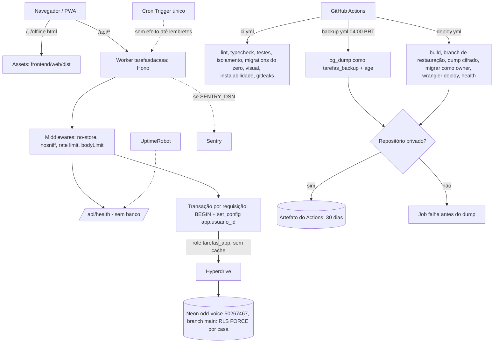

# Fundação — Design

**Spec**: `.specs/features/fundacao/spec.md`
**Status**: Approved (usuário, 2026-10-27)

> Arquitetura comum do projeto (AD-001). Referência de implementação: `C:\Leandro\Projetos\GestaoDaPelada_LJS` no commit `9a4afab` (fundação liberada em 2026-10-26, mesmo padrão LJS). Nas tabelas abaixo, `pelada:` indica um caminho relativo a essa pasta.

---

## Abordagem

| Abordagem | Como | Prós | Contras |
|---|---|---|---|
| **A. Copiar e adaptar do GestaoDaPelada_LJS (recomendada)** | Copiar infra, ferramentas, workflows, checagens, cliente de banco, middlewares e a infra do PWA; trocar `grupo` por `casa` e o visual pelo mockup aprovado. Cada teste copiado só entra ligado a um `FUN-NN` | Código já liberado em produção no mesmo padrão; os spikes S1 (contexto de RLS pelo Hyperdrive) e S2 (owner com bypass, dump com RLS) valem aqui | Herda decisões do outro app; exige limpar o que é do domínio dele |
| B. Do zero, pelo `padrao-ljs.md` | Montar tudo a partir do prompt do padrão | Nada herdado | Repete semanas de trabalho e os mesmos riscos que o Pelada já resolveu |
| C. Pacote/template LJS compartilhado | Extrair a fundação para um template usado pelos apps | Reuso futuro | Mudança fora deste projeto; não cabe numa ferramenta pessoal agora |

---

## Architecture Overview

Worker único na Cloudflare. Os assets estáticos saem sem custo de CPU e `/api/*` passa pelo Hono, que conecta no Neon pelo Hyperdrive com uma transação por requisição que define o contexto de RLS. CI, deploy e backup rodam no GitHub Actions. O repositório fica público durante o desenvolvimento e passa a privado antes da publicação final; enquanto for público, nenhum dump é gerado (FUN-44).



---

## Code Reuse Analysis

### Existing Components to Leverage

Política (igual à AD-002 do Pelada): infra, ferramenta e infra do PWA são **copiados** e ajustados só no que a spec muda. Testes copiados entram **só quando provam um critério** e ficam ligados a um `FUN-NN` no `tasks.md`; o verificador confere a ligação.

| Componente | Origem | Como usar |
| -------------------- | ------------------- | ------------------------- |
| Monorepo: `package.json` raiz, `pnpm-workspace.yaml`, `tsconfig.base.json`, `.prettierrc.json`, `.gitattributes`, `.gitleaks.toml`, `.nvmrc` | `pelada:` raiz | Copiar; trocar nomes |
| ESLint com o plugin próprio (domínio sem I/O, zonas de import) | `pelada: eslint.config.mjs`, `eslint/` | Copiar; tirar regras de telas do Pelada |
| Checagens do CI (migração aditiva, URLs absolutas, `wrangler deploy` único, actions fixadas por SHA, ids de tarefa) e testes | `pelada: backend/scripts/checagens/` | Copiar (FUN-19, FUN-40, FUN-52) |
| Trava de host e `seed`/`dev`/`migrar` | `pelada: backend/scripts/` | Copiar; o seed cria duas casas (FUN-05) |
| Cliente `pg` por requisição, transação de contexto, middlewares (`semCache`, `semSniff`, limite de taxa, `bodyLimit`) | `pelada: backend/api/src/` | Copiar; `app.conta_id` → `app.usuario_id`, sem `slug_publico` |
| Migrations de roles e RLS (padrão `grupos_visiveis()` `SECURITY DEFINER`) | `pelada: backend/api/src/infraestrutura/db/migracoes/` | Reescrever para `casa`/`membro` seguindo o mesmo padrão (C3) |
| Apoio de teste (banco temporário, cenário com dois grupos, contagem de linhas) e vitest da API com `@cloudflare/vitest-plugin` | `pelada: backend/api/test/apoio/`, `vitest.config.ts` | Copiar; cenário com duas casas |
| Teste de config do `wrangler.jsonc` (lista fechada de chaves) | `pelada: backend/api/test/wrangler.test.ts` | Copiar e atualizar chaves |
| Workflows `ci.yml`, `deploy.yml`, `backup.yml` e actions `preparar-node`, `dump-cifrado` | `pelada: .github/` | Copiar; destino do backup muda (C7) |
| Branches de restauração (manter 2) | `pelada: backend/scripts/ops/` | Copiar |
| Infra do PWA: `config/manifesto.ts`, `public/_headers`, `pwa/` (instalação no iOS, regras do SW, página offline), `app/App.tsx`, `dados/cliente.ts`, Stylelint, teste de instalabilidade | `pelada: frontend/web/` | Copiar **sem o visual**; visual vem de `.specs/mockup/` (C6) |
| Comparação visual | `.claude/scripts/comparar-visual.mjs` + `.specs/mockup/telas.json` | Já neste repositório |
| ADRs 024 a 028 do Pelada (migrations, RLS, instalabilidade, vitest plugin, host próprio) | `pelada: .md/adr/` | Base dos ADRs 001 a 005 daqui, reescritos para este app |
| Spikes S1 e S2 | `pelada: .specs/spikes/s1-contexto-rls/`, `s2-owner-force-dump/` | Evidência dos riscos de Hyperdrive e RLS; os testes de isolamento daqui confirmam de novo no local e no CI |

### Integration Points

| System | Integration Method |
| -------------- | --------------------------------------- |
| Neon | Projeto `odd-voice-50267467`, branch `main` = produção, `dev` = desenvolvimento. Roles `tarefas_app` e `tarefas_backup` criadas pelas migrations; senha definida pelo runbook, fora do repositório |
| Cloudflare | Worker novo `tarefasdacasa`, Hyperdrive novo (cache desligado), rota `tarefasdacasa.ljssoftware.com.br` com `custom_domain` (a zona já existe: os outros apps LJS usam) |
| GitHub | Repositório público `leandrosegheto17/TarefasDaCasa`, environment `producao` com secrets `NEON_*`, `BACKUP_CHAVE_PUBLICA`, `CLOUDFLARE_*`, `SENTRY_DSN` (opcional) e a credencial do destino do backup |

---

## Components

### C1. Monorepo e ferramentas

- **Purpose**: estrutura, scripts padrão e regras de qualidade (FUN-01, FUN-02, FUN-06, FUN-28, FUN-42).
- **Location**: raiz, `eslint/`, `backend/*/package.json`, `frontend/web/package.json`
- **Interfaces**: `pnpm lint | typecheck | test | migrar | seed | dev` na raiz.
- **Dependencies**: Node 24, pnpm 11, TypeScript 5.9, ESLint 10, Vitest 4, Prettier (versões do Pelada no commit de referência).
- **Reuses**: tudo da tabela acima. `.gitattributes` com `* text=auto eol=lf` (o `tokens.css` precisa ser idêntico byte a byte, FUN-26). `testes.json` passa a `{"comando": "pnpm test"}` (FUN-42).

### C2. Migrations

- **Purpose**: schema versionado (FUN-07, FUN-08, FUN-52).
- **Location**: `backend/api/src/infraestrutura/db/migracoes/` (SQL com `-- Up Migration`), `backend/scripts/migrar.ts`
- **Interfaces**: `pnpm migrar [--alvo local|producao]` com `node-pg-migrate` 9, `--no-single-transaction` (cada migration na sua transação) e advisory lock. Sem linha de base de legado: o banco nasce vazio.
- **Migrations da fundação**: `001_extensoes` (`pgcrypto`), `002_roles`, `003_casa_membro_usuario`, `004_rls`.

### C3. Roles e RLS por casa

- **Purpose**: isolamento por casa no Postgres (FUN-09 a FUN-14).
- **Location**: migrations `002_roles` e `004_rls`, `backend/api/test/isolamento/`
- **Interfaces (SQL)**:
  - Roles: `tarefas_app NOLOGIN NOBYPASSRLS`, `tarefas_backup NOLOGIN`; `LOGIN PASSWORD` pelo runbook (produção) e pelo `seed` a partir do `.env` (local). **owner** = `neondb_owner`, só no `migrar` (tem `BYPASSRLS`, conferido no S2 do Pelada).
  - `app_usuario_id()`: `nullif(current_setting('app.usuario_id', true), '')::uuid`.
  - `casas_visiveis()`: `SECURITY DEFINER`, `SET search_path = public, pg_temp`, retorna os `casa_id` de `membro` com `usuario_id = app_usuario_id()`; sem contexto, vazio. `REVOKE ALL FROM PUBLIC`, `GRANT EXECUTE` só a `tarefas_app`.
  - Policies em `casa` (por `id`) e em toda tabela com `casa_id`: leitura `USING (casa_id IN (SELECT casas_visiveis()))`; escrita com `WITH CHECK` igual mais `app_usuario_id() IS NOT NULL`. `ENABLE` + `FORCE ROW LEVEL SECURITY`.
  - `usuario`: RLS com `FORCE` e policy `id = app_usuario_id()`; sem grant para `tarefas_app` até a `conta-e-acesso`.
  - Grants de `tarefas_app` na fundação: `SELECT, INSERT, UPDATE` em `casa` e `membro`; `DELETE` em `membro` (sair da casa é regra prevista). Nunca `TRUNCATE` nem DDL.
  - `tarefas_backup`: `SELECT` em tudo e policy `USING (true)` só para ela; o dump usa `pg_dump --enable-row-security` (S2: sem a policy, o dump sai vazio com exit 0).
- **Testes-chave** (no banco, como `tarefas_app`, sem API): para cada tabela com `casa_id`, A lê só o seu; B não lê, não insere, não altera e não apaga nada de A; sem contexto, zero linhas. Meta-teste: tabela com `casa_id` sem RLS forçada ou sem caso de isolamento falha (FUN-10).
- **Reuses**: padrão do Pelada (`grupos_visiveis()`), cenário de duas casas.

### C4. API: Worker, Hono e contexto de banco

- **Purpose**: entrada única, saúde e transação de contexto (FUN-13, FUN-15 a FUN-21).
- **Location**: `backend/api/src/entrada/` (`worker.ts`, `app.ts`, `middlewares/`, `rotas/health.ts`, `agendado.ts`), `backend/api/src/infraestrutura/db/`
- **Interfaces**:
  - `GET /api/health → 200 {"status":"ok","versao": env.VERSAO}`, sem banco.
  - Middleware `comBanco`: abre o cliente na primeira consulta, `BEGIN` (`READ ONLY` em GET/HEAD), `SELECT set_config('app.usuario_id', $1, true)` com parâmetro, `COMMIT` se status < 400, senão `ROLLBACK`, e fecha no `waitUntil`.
  - `scheduled()`: registra a execução em log e retorna; a feature `lembretes` preenche (FUN-21).
  - `wrangler.jsonc`: `name: tarefasdacasa`, `assets` (SPA, `run_worker_first: ["/api/*"]`), `nodejs_compat`, `hyperdrive`, `ratelimits` 4001 a 4003, `routes` com `custom_domain`, `triggers.crons` com **uma** expressão (`0 * * * *`, de hora em hora; a feature `lembretes` pode trocar a expressão sem gastar outro slot).
- **Dependencies**: Hono 4, Kysely 0.29, `pg` 8, Hyperdrive com `--caching-disabled` (o deploy confere, FUN-15).

### C5. Observabilidade

- **Purpose**: FUN-22 a FUN-24.
- **Interfaces**: `@sentry/hono/cloudflare` no Worker e `@sentry/react` no front, só com DSN; `release = VERSAO`; `beforeSend` remove corpo, cookies, `authorization` e e-mails. Runbook com o passo do UptimeRobot.
- **Reuses**: `pelada: backend/api/src/entrada/worker.ts`, `frontend/web/src/app/observabilidade.ts`.

### C6. Front: shell PWA

- **Purpose**: FUN-25 a FUN-34.
- **Location**: `frontend/web/`
- **Interfaces**:
  - Rota `/`: página provisória (mockup `telas/provisoria.html`). `public/offline.html`: página offline (mockup `telas/offline.html`), servida pelo SW no fallback de navegação.
  - `src/estilos/tokens.css` = cópia de `.specs/mockup/tokens.css`; `src/estilos/componentes/` = os componentes de `.specs/mockup/componentes.css` como CSS Modules com os mesmos nomes de classe, cada um com teste de renderização e axe (FUN-27).
  - **Fontes locais**: Sora e Source Sans 3 (licença OFL) em `public/fontes/` com `@font-face` em `fontes.css`. O mockup passa a usar os mesmos arquivos (`.specs/mockup/fontes/`) e o `@import` do Google Fonts sai do `tokens.css` (T de ajuste do mockup, republicado). Motivo: CSP mais fechada, offline do PWA e "mesma fonte no mockup e no app".
  - Manifest "Tarefas da Casa", `pt-BR`, `standalone`, ícones 192/512 (um `maskable`), gerados a partir de um ícone desenhado nos tokens.
  - Cabeçalhos em `public/_headers`: CSP (`default-src 'self'`; sem host externo, já que as fontes são locais), `nosniff`, `Referrer-Policy`, HSTS (FUN-25).
  - Comparação visual no CI com `.specs/mockup/telas.json` (T1 provisória, T2 offline).
- **Dependencies**: React 19, React Router 8, TanStack Query 5, Vite 8, `vite-plugin-pwa` 2 (`injectManifest`), Workbox 7, Playwright.

### C7. CI/CD e backup

- **Purpose**: FUN-35 a FUN-46, FUN-53, FUN-54.
- **Location**: `.github/workflows/{ci,deploy,backup}.yml`, `.github/actions/`
- **Ajustes sobre o Pelada**:
  - Repositório **público**: `ci.yml` roda em PR de fork sem secrets (não precisa de nenhum); `deploy.yml` e `backup.yml` só no environment `producao`, por `workflow_dispatch`/agendamento na `main`; actions fixadas por SHA (checagem copiada).
  - Backup como **artefato do Actions** do próprio repositório, `retention-days: 30` (padrão LJS, decisão do usuário em 2026-10-27). Primeiro passo da action `dump-cifrado`: se `github.event.repository.private != true`, o job falha com "Torne o repositório privado antes do backup" antes do `pg_dump` (FUN-44). Vale para o `backup.yml` e para o passo 3 do `deploy.yml`, então o **primeiro deploy em produção exige o repositório privado**.
  - Falha no dump ou na cifragem deixa o job vermelho e não sobe artefato (FUN-45).
  - Cota de artefatos do plano Free em repositório privado: 500 MB (pesquisa de 2026-10-27). O banco de uma família cabe com folga; o runbook registra o tamanho do primeiro dump.
  - Concurrency `deploy-producao` com `cancel-in-progress: false` (FUN-53); falha explícita sem `URL_PUBLICA` (FUN-54).

### C8. Documentação

- **Purpose**: FUN-47 a FUN-50.
- **Location**: `README.md`, `docs/runbook.md`, `.md/` (PRD, PRD-TECNICO, SDD, GUARDRAILS, THREAT-MODEL, `adr/`), `CLAUDE.md` da raiz.
- **Cuidado (repositório público)**: nada de segredo, host interno, e-mail pessoal ou dado da família nos documentos; gitleaks no CI.

---

## Data Models

```sql
usuario (id uuid PK DEFAULT gen_random_uuid(), criado_em timestamptz NOT NULL DEFAULT now())
  -- a feature conta-e-acesso acrescenta e-mail, nome, senha etc.
casa (id uuid PK DEFAULT gen_random_uuid(), nome text NOT NULL CHECK (char_length(nome) BETWEEN 1 AND 60),
      criada_em timestamptz NOT NULL DEFAULT now())
membro (id uuid PK DEFAULT gen_random_uuid(), casa_id uuid NOT NULL REFERENCES casa ON DELETE CASCADE,
        usuario_id uuid NULL REFERENCES usuario,       -- NULL = perfil sem login (D-02)
        apelido text NOT NULL CHECK (char_length(apelido) BETWEEN 1 AND 40),
        criado_em timestamptz NOT NULL DEFAULT now(),
        UNIQUE (casa_id, usuario_id))
pgmigrations (padrão do node-pg-migrate)
```

**Relationships**: a RLS liga `casa` e `membro` (e toda tabela futura com `casa_id`) ao usuário da sessão por `membro.usuario_id`. Nada no schema impede um usuário em várias casas (premissa aprovada).

---

## Error Handling Strategy

| Error Scenario | Handling | User Impact |
| -------------- | ------------- | ---------------- |
| Banco local fora do ar | `migrar`, `seed` e `dev` param com "Rode `docker compose up -d`" (FUN-51) | Desenvolvedor vê o passo que falta |
| Migração falha no deploy | A migration reverte a si mesma; o job para antes do `wrangler deploy`; runbook indica a branch de restauração (FUN-39) | O app anterior segue no ar |
| Erro com transação aberta | `ROLLBACK`, 500 genérico e Sentry se houver DSN | Estado de erro do guia |
| Sem contexto de RLS | Zero linhas (FUN-12) | 404 nas rotas das features |
| Sentry fora do ar ou sem DSN | Nenhum envio, a requisição não espera (FUN-23) | Nenhum |
| Health com versão diferente após o deploy | Job vermelho com `wrangler rollback` | Volta à versão anterior |
| Backup falha (dump, cifra ou envio) | Job vermelho, arquivo parcial removido (FUN-45) | Nenhum; aviso por e-mail do GitHub ao dono |
| Sem rede no celular | SW serve `offline.html` (FUN-31) | Página "Sem conexão" |

---

## Risks & Concerns

| Concern | Location (file:line) | Impact | Mitigation |
| ------- | -------------------- | ------ | ---------- |
| Repositório público expõe workflows, ADRs e runbook | `.github/`, `.md/`, `docs/` | Vazamento de segredo ou dado da família | Gitleaks no CI; checagem de URLs absolutas; secrets só no environment `producao`; documentos sem dado pessoal (C8); seed com nomes fictícios |
| Esquecer de tornar o repositório privado antes de publicar | `dump-cifrado`, runbook | Deploy em produção sem backup | A trava do FUN-44 faz o deploy falhar no passo 3, antes de migrar ou publicar; o runbook lista "tornar privado" como primeiro passo da publicação |
| Ao virar privado, o Actions passa a ter cota (2.000 min/mês, 500 MB de artefatos) | `.github/workflows/` | CI ou backup parando por cota | CI enxuto (cache do pnpm, Playwright só com Chromium); runbook acompanha o uso mensal |
| PR de fork rodando o CI | `ci.yml` | Exfiltrar secrets | `ci.yml` não usa secret nenhum; `pull_request` (nunca `pull_request_target`); deploy e backup só na `main` com environment |
| Cron Triggers no limite da conta (5) | `wrangler.jsonc` | Deploy recusado se outro app criar mais crons | Um cron só aqui (FUN-21); runbook registra a contagem por app (ControleEmCasa 2, EvolucaoSegura 1) |
| `namespace_id` do rate limit repetido entre apps | `pelada: wrangler.jsonc:27-29` | Contadores compartilhados entre apps | Faixa 4001 a 4003 aqui; aviso registrado para os outros apps |
| `tokens.css` deixa de ser idêntico por conversão de fim de linha | `.gitattributes` | FUN-26 falha no Windows | `eol=lf` no `.gitattributes`; o teste compara bytes |
| Criar casa antes de existir `membro` (ovo e galinha da RLS) | `004_rls` | A feature 3 não consegue criar casa como `tarefas_app` | Fica para `casa-e-membros`: função `criar_casa()` `SECURITY DEFINER` que cria casa e membro juntos; registrado aqui para não esquecer |
| `SECURITY DEFINER` em `casas_visiveis()` | `004_rls` | Escalada pelo `search_path` | `SET search_path = public, pg_temp`, dono owner, `REVOKE ALL FROM PUBLIC` |
| Herdar código do Pelada que não prova critério | política de reuso | Cobertura enganosa, código morto | Cada teste copiado ligado a `FUN-NN`; o que não for ligado sai |

---

## Tech Decisions (only non-obvious ones)

| Decision | Choice | Rationale |
| ----------------- | --------------- | ------------- |
| Reuso | Copiar e adaptar do GestaoDaPelada_LJS (`9a4afab`) | Mesma stack, fundação já liberada; spikes S1/S2 valem |
| Modelo de RLS | `set_config('app.usuario_id', …, true)` por transação; `casas_visiveis()` `SECURITY DEFINER`; escrita só com usuário | D-06; mesmo padrão validado no Pelada |
| Fontes | Locais (OFL), mesmos arquivos no mockup e no app | CSP sem host externo, offline do PWA |
| Cron | Uma expressão, de hora em hora, handler vazio | Reserva o slot da conta (FUN-21) |
| Backup | Artefato do Actions (30 dias), com trava que recusa repositório público | Decisão do usuário; o repositório fica privado antes da publicação. Alternativas pesquisadas e descartadas: release em repo privado separado e Cloudflare R2 (pesquisa de 2026-10-27) |
| ADRs | Numeração própria a partir de 001, reescrevendo os ADRs 024 a 028 do Pelada | App novo; o histórico do Pelada não se aplica |
